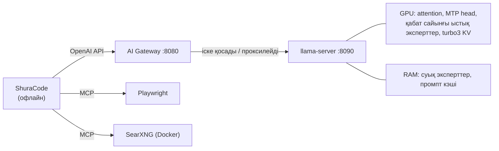

<div align="center">

<picture>
  <source media="(prefers-color-scheme: dark)" srcset="assets/logo-wordmark-dark.png">
  
</picture>

### Бір 12 ГБ бейнекартада 200k контексті бар 35B бағдарламалау моделі, ал жұмыс үстелі өзіңізде қалады

[](LICENSE)


[](https://github.com/hikkian/shura/actions/workflows/ci.yml)

[English](README.md) · [Русский](README.ru.md) · Қазақша

</div>

---

> *Шура* (شورى) арабша «кеңес, кеңесу» деген мағынаны білдіреді. Mixture-of-Experts моделінде әр токенді
> кеңес шешеді: маршрутизатор 256 эксперттің 8-імен кеңеседі. Бұл жоба осындай кеңесті қарапайым
> құрылғыда жинауға арналған.

## Shura дегеніміз не

Qwen3.6-35B-A3B сияқты MoE модельдері жергілікті бағдарламалауға тамаша сәйкес келеді: білім 35B
параметрге жетеді, ал әр токенге небәрі ~3B жұмыс істейді. Қиындығы көлемінде. Модель **18 ГБ** тартады,
жақсы үйлік бейнекартада **12 ГБ** бар, ал код агентіне оның үстіне **200k токен контекст** керек.

Shura дегеніміз осының бәрін кәдімгі үй компьютерінде жұмыс істетін бапталған, өлшенген және буып-түйілген
конфигурация:

- **ыстық эксперттер VRAM-да тұрады**, қалғандары жедел жадта, оларды CPU төмендетілген басымдылықпен есептейді;
- **KV кэш қысылған** (TurboQuant), ал босаған VRAM тағы да көп ыстық эксперттерге беріледі;
- **модельдің өзіндегі MTP head** спекулятивті декодтау үшін токен жобаларын жазады (генерация +32%);
- шағын **gateway** модельді қажет болғанда жүктейді, сессияларды RAM-да ұстайды және SSD-ді сақтайды;
- үстінде **ShuraCode**, бағдарламалауға арналған офлайн агент жұмыс істейді.

Мақсат бенчмарктегі рекорд емес. Мақсат — сол компьютерде браузерді, IDE-ні, мессенджерлерді және қоңырауларды
қолдана беруіңізге болатын, өзі жұмыс істеп тұратын код көмекшісі.

| Қысқаша | |
|---|---|
| Модель | [Tiel-Coder-35B-A3B-MTP](https://huggingface.co/peculiar-ragdoll/Tiel-Coder-35B-A3B-GGUF-MTP), `UD-IQ4_XS`, 18 ГБ |
| Тексерілген құрылғы | RTX 4070 SUPER 12 ГБ · Ryzen 5 5600 · 32 ГБ DDR4-3200 · Fedora 44 (бір машина) |
| Контекст | 200k терезе, өлшемдер **~187k нақты толтырылған токенмен** жасалған |
| 187k кезіндегі генерация жылдамдығы | тыныш жұмыс үстелінде **38–39 токен/с**, жүктелген жұмыс үстелінде **34–37** ([толығырақ](#нәтижелер)); 64k-ға дейін ~50–54 |
| Сессияға оралу | сессиялар арасында 1.9 с, модельді толық қайта жүктегеннен кейін ~13 с |
| Генерация кезіндегі интерфейс кідірісі | p99 0.1–0.3 мс (бос тұрғанда: 0.1–0.5 мс) |
| Бәрі офлайн | инференс, веб-іздеу, браузерді басқару |

> [!IMPORTANT]
> Бұл сандар **бір машинада** алынған. Басқа бейнекарталарда, процессорларда және жад жылдамдықтарында нәтиже
> басқаша болады, ал бапталымды қайтадан таңдау керек болады. [Тексерілген орта және шектеулер](#тексерілген-орта-және-шектеулер) бөлімін қараңыз.

## Мұнда не жаңа

Жылдамдықтың көп бөлігі өзгелердің тамаша жұмысының арқасында (олар төменде аталған). Бұл репозиторийдің өз
үлесі: 12 ГБ карточкада нақты не маңызды екенін анықтау, оны сенімді ету және жұмыс үстелімен тіл табысып
жұмыс істейтін ету:

| | Не | Неге маңызды |
|---|---|---|
| **Өлшенген рецепт** | Қарапайым llama.cpp-ден (26.1 токен/с) нақты 187k контексттегі 38.3 токен/с-қа дейінгі қайталанатын баптау жолы, сәтсіз болған барлық идеяларды қоса алғанда | Көптеген танымал айла 12 ГБ-та 200k контекстке жарамады; сәтсіздіктер де сипатталған |
| **Генерацияланған токендер бойынша маршрутизация профилі** | Қандай эксперттерді VRAM-да ұстау керектігі промпттар бойынша емес, агенттік сессияларда *генерацияланған* токендер бойынша шешіледі | Ұзын промпттардан құрылған профиль генерация үшін кішкентай синтетикалық профильден *нашар* |
| **Гибридті модельдерде сессияның үздіксіздігі** | Слотты save/restore жасағанда контекстің бақылау нүктелерін сақтау ([llama.cpp #25913](https://github.com/ggml-org/llama.cpp/issues/25913) жөніндегі апстрим түзетуіне негізделген, қосымша тұтастықты тексеру бар) | Модель жүктен түскеннен кейін 187k сессия ~290 с орнына ~30 токенді қайта оқу арқылы жалғасады (қолмен қосылады) |
| **SSD-ді аялайтын gateway** | Сессиялар RAM-да қалады; модель жүктен түскенде ғана бір файл жазылады | Әр жауаптан кейін сақтау болжам бойынша тәулігіне 135–640 ГБ жазар еді |
| **Жұмыс үстелін ескеретін VRAM күзетшісі** | Бос VRAM азайғанда сессия RAM-ға жасырылады, ал модель жұмыс үстеліне орын береді (қолмен қосылады) | Жұмыс үстелінің бейнежады тұрақты емес ([біз нені анықтадық](#біз-нені-анықтадық) бөлімін қараңыз) |
| **Құрылғыны ескеретін орнатқыш** | Нақты GGUF тақырыптарынан RAM/VRAM көлеміңізге сай кванты таңдайды, карточкаңызға арнап жинайды, раскладкаларды өлшейді | Бір команда; Fedora, Ubuntu/Debian және Arch үшін жазылған |
| **ShuraCode** | Тұрақты жады, тек оқуға арналған Plan режимі және өзін-өзі тексеретін қозғалтқыш жаңартулары бар офлайн агент | [Жеке репозиторийде](https://github.com/hikkian/shuracode) тұрады |

> [!NOTE]
> **Жоба өзгелердің еңбегіне құрылған.** [**thecodacus**](https://github.com/thecodacus) MoE эксперттері кэші мен
> TurboQuant бар llama.cpp `perf`-форкын жазды, ал оның бенчмарктері мұның мүмкін екенін көрсетті.
> **wilky2005** TurboQuant-ты осы модельдер тұқымдасы үшін түзетті. **peculiar-ragdoll** Tiel-Coder-ді жасады.
> [**llama.cpp**](https://github.com/ggml-org/llama.cpp) — іргетас, ал [**OpenCode**](https://github.com/anomalyco/opencode) —
> ShuraCode астындағы қозғалтқыш. Толық тізім: [Алғыстар](#алғыстар). Қайсысы біздікі, қайсысы алынған,
> жоғарыдағы кестеде және [docs/ARCHITECTURE.md](docs/ARCHITECTURE.md) файлында айтылған.

## Нәтижелер

**Толтырылған контекстегі** генерация жылдамдығы (әр іске қосу алдында сақталған слот қалпына келтіріледі,
200 токеннен 3–5 іске қосудың медианасы), тыныш жұмыс үстеліндегі 24 эксперт слотты қорытынды конфигурация:

| Толтырылған контекст | 4k | 16k | 32k | 64k | 128k | 187k |
|---|---:|---:|---:|---:|---:|---:|
| Генерация, токен/с | 53.9 | 53.2 | 50.8 | 49.4–51.5 | 42.4 | **38.6–39.2** |

Жылдамдыққа қалай жеттік (~187k кезіндегі 5 сұраныс бойынша орташа):

| Қадам | Орташа, токен/с |
|---|---:|
| Қарапайым llama.cpp, әдепкі баптаулар | 26.1 |
| + `--load-mode none` (mmap-сыз) | 29.7 |
| + MoE эксперттері кэші бар perf-форк (16 слот) | 35.9 |
| + KV үшін түзетілген TurboQuant `turbo3`, ол 24 слотқа орын береді | **38.3** |

MTP head барлық жолдарда қосулы (жобалардың ~85%-ы қабылданады). Барлық өлшемдер, әдістемені және
жұмыс істемеген идеяларды қоса алғанда, **[docs/BENCHMARKS.md](docs/BENCHMARKS.md)** файлында жиналған.

| 187k кезіндегі сессияға оралу | Уақыт |
|---|---:|
| Суық prefill | 264 с |
| Басқа сессияларда жұмыс істегеннен кейін оралу (RAM-дағы промпт кэші) | **1.9 с** |
| Модельді толық жүктен түсіріп, қайта жүктегеннен кейін (слот дискіден қалпына келтірілді) | **13 с** |
| …және келесі промпт агенттер істейтіндей алдыңғы қадамды қайта жазады: бақылау нүктелерінсіз | ~290 с (толық қайта есептеу) |
| …сол жағдай сақталған бақылау нүктелерімен (қолмен қосылады) | **~1 с қалпына келтіру + ~30 жаңа токен** |

| Генерация кезіндегі жұмыс үстеліне әсері | |
|---|---:|
| Интерфейс жоспарлағышының кідірісі, p99 | 0.1–0.3 мс |
| Браузер, IDE және мессенджер ашық тұрғанда бос RAM | 32 ГБ-тың ~12.5 ГБ-ы |
| Модельдің CPU ағындары | 12-нің 6-ы, төмендетілген басымдылықпен |

> [!WARNING]
> **Басты ескерту: VRAM жұмыс үстелімен ортақ.** 24 эксперт слоты 12 ГБ карточканың шамамен 10.9 ГБ-ын алады.
> Компьютерде браузер, мессенджер ашық тұрып, бейнеқоңырау жүріп жатса, бос бейнежад 150 МиБ-тан азайып кетуі
> мүмкін (жұмыс үстелінің бейнежады ±270 МиБ шамасында ауытқиды, тек бұғаттау экранының өзі ~350 МиБ алады).
> Сондықтан мұндай машинада қазіргі тұрақты баптау — 187k кезінде **12–16 слот және 34–37 токен/с**. CPU-ның бір
> бос емес ядросы тағы 6–7% жейді. Жұмыс барысында өлшемін өзі өзгертетін кэш әзірленуде ([Күйі](#күйі) бөлімін қараңыз).

## Бұл қалай жұмыс істейді



Алғашқы 26 қабаттың эксперттері жедел жадта тұрады, ал суықтарын CPU төмендетілген басымдылықпен 6 ағында
есептейді; ең жиі қажет болатындары бейнежадта қалады, оларды маршрутизация профилі таңдайды. Кіріктірілген
MTP head бір токен алға жоба жазады. TurboQuant KV кэшті ыстық эксперттердің 16 орнына 24 слоты сыятындай етіп
қысады. Gateway модельді қажет болғанда іске қосады, құлаудан аман қалады, мәтіндік және vision режимін өзі
ауыстырады және сессиялардың күйін RAM-да ұстайды. Құрылымы мен эндпойнттері: **[docs/ARCHITECTURE.md](docs/ARCHITECTURE.md)**.

## Біз нені анықтадық

- **Эксперттер кэші — басты рычаг, бірақ слот тым көп болса, зиян білінбей келеді.** VRAM асып кетсе, қате
  шықпайды, жұмыс бірте-бірте баяулайды, ал конфиг дұрыс жүктеліп, толық контекстте генерация ортасында
  жад жетпей құлап қалуы мүмкін.
- **Промптты оқығанда және генерация кезінде әртүрлі эксперттер жұмыс істейді.** Маршрутизация профилін
  генерацияланған токендерден алу керек.
- **TurboQuant өздігінен генерацияны жылдамдатпайды.** Оның құндылығы — KV кэштен үнемделген VRAM-ды қосымша
  эксперт слоттарына беруде. Сонымен қатар head_dim 256 модельдерінде ол [түзетуді](docs/TURBOQUANT-FIX.md)
  қажет етеді: онсыз сервер құлайды немесе үнсіз қате жауап береді.
- **Физикалық ядролар санынан асатын CPU ағындары ештеңе бермейді.** CPU жағындағы есептеу жад өткізу
  қабілетіне тіреледі.
- **Гибридті модельдерге контекстің бақылау нүктелері керек, ал слотты сақтау оларды сақтамайды.** Оларсыз
  промпттың басы өзгерсе, контексті түгел қайта есептеуге тура келеді.
- **Жұмыс үстелі тұрақты емес.** Оның бейнежады жүздеген МиБ-қа ауытқиды (қоңыраулар, бейне, бұғаттау экраны),
  ал CPU-ның бір бос емес ядросы жылдамдықтың 6–7%-ына түседі. Тіркелген раскладка бір мезгілде жылдам да,
  қауіпсіз де бола алмайды.

<details>
<summary><b>Мұнда жұмыс істемеген идеялар</b> (бәрі өлшенген)</summary>

Үлкен кэші бар барлық эксперттер CPU-да · host-register және эксперттерді prefetch жалаушалары (кэш қосулы
болғанда зиян келтіреді) · ұлғайтылған `ubatch` · қысылған MTP жоба кэші · слоты көбірек жеке «қалыпты» 100k профилі
(сол тереңдікте жылдамырақ емес) · 200k контексте 24 эксперт слотынан артық (жылдамдық төмендейді). Қараңыз:
[docs/BENCHMARKS.md](docs/BENCHMARKS.md).

</details>

## Күйі

| Бөлім | Жағдайы |
|---|---|
| Бапталған llama.cpp жинағы, маршрутизация профилі, gateway, орнатқыш, ShuraCode | **Жұмыс істейді**; автор сынақ машинасында қолданады |
| Контекстің бақылау нүктелерін сақтау (`slotSaveCheckpoints`) | Іске асырылған және сынақтарда қабылданған; **қолмен қосылады**, әдепкіде өшірулі |
| VRAM күзетшісі (`vramGuard`): бейнежад жетпегенде сессияны RAM-ға жасырады | Іске асырылған және сынақтарда қабылданған; **қолмен қосылады**, әдепкіде өшірулі |
| Жұмыс барысында өлшемін өзі өзгертетін эластикалық эксперттер кэші | **Әзірленуде.** CUDA виртуалды жадындағы прототип VRAM-ды карточкаға миллисекундтарда қайтара алады; сапаны тексеру аяқталған жоқ, релизге кірмейді |
| AMD, Intel, Apple, Windows және GPU жоқ машиналарға арналған әмбебап орнатқыш (`shura install`) | **Эксперименттік, мұндай құрылғыда әлі іске қосылмаған.** Модульдік тестілермен және жалған серверлерде тексерілген; [не тексерілді](#не-тексерілді-және-не-тексерілмеді) бөлімін қараңыз |
| 187k кезінде жылдамырақ attention (`scripts/build-llama.sh --attention-decode`) | Автордың машинасында іске асырылған және сынақтарда қабылданған; **қолмен қосылады**, әдепкіде өшірулі. 187k кезінде attention ядросы 17%-ға, генерация шамамен 5%-ға жылдам, сапа өзгермеді ([BENCHMARKS](docs/BENCHMARKS.md) қараңыз) |

## Жылдам бастау

NVIDIA бейнекартасы және оның драйвері орнатылған Fedora, Ubuntu/Debian немесе Arch жүйесінде:

```bash
curl -fsSL https://raw.githubusercontent.com/hikkian/shura/main/setup.sh | bash
# немесе: git clone https://github.com/hikkian/shura.git && cd shura && ./setup.sh
```

Орнатқыш RAM мен VRAM көлеміңізге сай Tiel-Coder кванты таңдайды (жоспарлағыш 16 ГБ RAM-ды қолдайды), llama.cpp-ді
бейнекартаңызға арнап жинайды, карточкаңызда бірнеше раскладканы өлшейді және қажеттің бәрін орнатады. Әрбір
`sudo` қадамының алдында ол рұқсат сұрайды. Параметрлер (`--quick`, `--quant`, `--model`, `--no-search`) және ол
өзгертетін нәрселердің толық тізімі: **[docs/INSTALLER.md](docs/INSTALLER.md)**. Қолмен орнату: **[docs/INSTALL.md](docs/INSTALL.md)**.

## Күнделікті қолдану

Бәрі жұмыс үстелі сессиясымен бірге басталады, қолмен ештеңе іске қосудың қажеті жоқ.

- **Қолданбалар мәзірі → Shura.** Жоба папкасын таңдаңыз, ShuraCode сол жерде өз терезесінде ашылады. Белгішені
  тінтуірдің оң жақ батырмасымен басқанда *Модельді қазір жүктеу* / *Модельді жүктен түсіру* қолжетімді. Кез келген
  ортада және кез келген кең таралған терминалмен жұмыс істейді (қажетті терминалды `SHURA_TERMINAL` арқылы беруге болады).
- **Терминал:** жобаға өтіп, `shura` деп теріңіз. Модель фонда жүктеле бастайды.

```
shura status    # модель күйі, бос RAM/VRAM, бос тұру таймері
shura warm      # модельді қазір жүктеу       shura unload   # RAM/VRAM-ды қазір босату
shura off / on  # ЖИ-ді өшіру / қосу          shura logs     # логтарды қарау
shura window    # ағымдағы папка үшін жаңа Shura терезесі
```

Модель 30 минут бос тұрғаннан кейін өзі жүктен түседі; соңғы ұзын сессия сақталады және келесі іске қосқанда
қалпына келтіріледі.

**ShuraCode** — бағдарламалауға арналған агент: барлық сессияға ортақ тұрақты жады, `/remember` `/forget`
`/memory` `/test` `/commit` командалары, **Build** режимінің қасындағы тек оқуға арналған **Plan** режимі (Tab)
және төменгі жолақтағы модельдің тікелей күйі. Бұл OpenCode қозғалтқышының үстіндегі біздің қондырма, жеке
репозиторийде: **[hikkian/shuracode](https://github.com/hikkian/shuracode)**; орнатқыш оны өзі баптайды.

## Өз құрылғыңызда іске қосу

Shura модель мен баптауларды компьютеріңіздің маркасына қарап емес, не істей алатынына қарап таңдайды: жадының
жылдамдығы қандай (ол өлшенеді), қанша екені, бейнекартада не бар және қай бэкенд шынымен жұмыс істейді.

```bash
git clone https://github.com/hikkian/shura && cd shura
./scripts/shura check             # компьютеріңіз нені көтереді және қаншалықты жылдам (ештеңе орнатпайды және жібермейді)
./scripts/shura install --dry-run # не жүктелетіні және қанша орын керек екені (ештеңе жүктемейді)
./scripts/shura install           # жүктеу, тексеру және баптау; содан кейін `shura start` / `shura stop`
./scripts/shura report --issue    # GitHub issue үшін жекеленбеген есеп: құрылғысы сіздікіндей барлық адамға көмектеседі
```

Windows-та `scripts\shura.cmd` (немесе `py installer\universal\cli.py`) қолданыңыз. Windows компиляторсыз RAM жылдамдығын өлшей алмайды: `--ram-gbs 40` қосыңыз (екі DDR4-3200 планка; DDR5-6000 үшін шамамен 80). Linux-тағы NVIDIA жылдам деңгейді
(біздің CUDA-форк) `setup.sh` арқылы алады, `shura install` соған бағыттайды. Қалған барлық машинаны `shura install` өзі
орнатады, ештеңе компиляциялаусыз және root-сыз.

`shura install` сәтсіз күн ештеңеге түспейтіндей етіп жасалған: жүктеу алдында сұрайды; алдымен бос орынды тексереді;
үзілген жүктеу **жалғасады**; әр файл тексеріледі (көлемі мен SHA-256); таңдалған баптаулармен нағыз серверді іске қосып,
олардың жұмыс істейтінін **дәлелдейді**; жад жетпесе, жоспар үлкенірек қормен қайта есептеліп, іске қосу қайталанады; ал
ештеңе жұмыс істемесе, жеке деректерсіз есеп қалады, ал жүктелгені сақталады, сонда келесі іске қосу нөлден
басталмайды. `shura uninstall` өзі қойған барлық нәрсені жояды.

> [!NOTE]
> Мүмкін болған жерде (Linux-тағы Vulkan, Apple Silicon-дағы Metal, NVIDIA бар Windows-тағы CUDA) `shura install` сондай-ақ
> turbo KV кэші, эксперттер кэші және MTP бар llama.cpp-дің **үшінші тарап** форкін де сынайды
> ([TheTom/llama-cpp-turboquant](https://github.com/TheTom/llama-cpp-turboquant), бекітілген релиз, архив осы
> репозиторийде жазылған SHA-256-мен салыстырылады). Ол сіздің машинаңызда қарапайым llama.cpp-ге қарсы өлшенеді, ал ең жылдамы қалады. Өндірушінің өз стегі (AMD-де ROCm, NVIDIA-да CUDA, Intel-де SYCL, Apple-де Metal)
> сіздің машинаңызда басқасы 10%-ға жылдам болмайынша негізгі болып қала береді. `shura install --no-turbo` үшінші тарап кодын қолданбайды.

- **Құрылғы түрі бойынша емес, ресурстар бойынша кластар:** жедел жады бар бейнекарта, бірыңғай жад (Apple) немесе тек
  процессор. «Тек процессор» «шағын модельдер» дегенді білдірмейді: көп арналы сервер 12 ГБ карточкаға сыймайтын
  модельдерді тарта алады.
- **Бэкендтер:** NVIDIA (CUDA, Vulkan), AMD (ROCm немесе Vulkan, өлшем бойынша қайсысы жылдам), Intel (SYCL, Vulkan,
  OpenVINO), Apple (Metal) немесе CPU. llama.cpp-дің дайын жинақтары алынады, компьютеріңізде ештеңе компиляцияланбайды.

### Не тексерілді және не тексерілмеді

> [!WARNING]
> **Shura нағыз жұмыс істеген бір ғана машина бар** (RTX 4070 SUPER 12 ГБ, Ryzen 5 5600, 32 ГБ DDR4, Fedora 44).
> Төмендегі қалған бәрі жазылған, бағдарламалық түрде тексерілген және біздің ойымызша жұмыс істеуге тиіс, бірақ
> **мұндай құрылғыда әзірге ешкім іске қосып көрмеген**. Сіз бірінші болуыңыз мүмкін, ал сіздің нәтижеңіз —
> жібере алатын ең пайдалы нәрсе.

| Сіздің машинаңыз | Қалай орнатылады | Күйі |
|---|---|---|
| NVIDIA, Linux, 12 ГБ VRAM + 32 ГБ RAM | `setup.sh` (біздің CUDA-форк) | Автордың машинасында **тексерілген** |
| NVIDIA, Linux, басқа көлемдер (8, 16, 24 ГБ; 16 ГБ RAM) | `setup.sh` | **Тексерілмеген.** Жоспар бір машинаға бейімделген модель бойынша есептеледі |
| AMD (ROCm немесе Vulkan), Intel (SYCL, Vulkan, OpenVINO) | `shura install` | **Нағыз GPU-да тексерілмеген** |
| Apple Silicon (Metal) | `shura install` | **Тексерілмеген** |
| Windows (кез келген GPU немесе процессор) | `shura install` | **Тексерілмеген**; тек модульдік тестілер мен CI |
| Тек процессор, көп арналы серверлерді қоса алғанда | `shura install` | **Тексерілмеген**; жылдамдық болжамдары мұнда ең сенімсіз |

Әр коммитте автоматты түрде не тексеріледі (CI): Linux, macOS және Windows жүйелеріндегі модульдік тестілер; нағыз
llama.cpp жинағы жүктеліп, 19 МБ модельде іске қосылады (Linux пен Windows-та CPU жинағы, macOS-та CI виртуалды машинасының ішінде Metal жинағы); Vulkan жинағы бағдарламалық
драйверде іске қосылады (эксперименттік); `shura install` `llama-server`-ге беретін жалаушалар бекітілген
релиздің (b11301) нағыз `--help` мәтінімен салыстырылған.

**Ешкім тексермегені:** автордікінен басқа нағыз бейнекарта; 17 ГБ нағыз модельді басқа құрылғыда жүктеу;
жылдамдық болжамдары (бұл бір машинаға бейімделген бағалар, олар диапазонмен көрсетіледі, ал жоспар сервердің нағыз
іске қосылуымен тексеріледі); Windows-та серверді іске қосу және тоқтату; 15 минуттан ұзақ жүктелу (орнатқыш күтуді тоқтатады).

### Тексеруге көмектесіңіз

1. `./scripts/shura check` іске қосып, жоспарды қараңыз: ол сіздің машинаңыз үшін шындыққа ұқсай ма?
2. `./scripts/shura install --dry-run`, содан кейін `./scripts/shura install`.
3. Нәтиже қандай болса да, **[Hardware report](https://github.com/hikkian/shura/issues/new?template=hardware_report.md)**
   issue-сін ашыңыз. `./scripts/shura report --issue` дайын сілтемені басып шығарады; есепте аттар, жолдар мен
   идентификаторлар жоқ, ал GitHub-та батырманы өзіңіз баспайынша ештеңе жөнелтілмейді.
   - **Жұмыс істеді:** нақты жылдамдықты (токен/с) және контекст көлемін жазыңыз. Есепте біз болжағанымыз бар;
     екеуінің арасындағы айырма — болжамдардың түзетілу тәсілі.
   - **Жұмыс істемеді:** Shura папкасынан `logs/verify.log` файлын тіркеңіз (`~/.local/share/shura`, `~/Library/Application
     Support/shura` немесе `%LOCALAPPDATA%\shura`) және қай жерде тоқтағанын жазыңыз. Сәтсіз орнату сәтті орнатудан кем пайдалы емес.
   - **Өзіңіз түзеттіңіз:** не дұрыс емес болғанын сипаттап, өзгерісті жіберіңіз.
4. Машиналар класы жоғарыдағы кестеде нағыз өлшемі бар есеп келгенде *тексерілмеген* күйінен *тексерілген* күйіне өтеді.

Шешім қалай қабылданады: **[docs/HARDWARE.md](docs/HARDWARE.md)**. Өз құрылғыңызды, модельді немесе бэкендті қосу үшін:
**[CONTRIBUTING-hardware.md](CONTRIBUTING-hardware.md)**.

## Тексерілген орта және шектеулер

> [!NOTE]
> Мұндағы бәрі **бір машинада** әзірленіп, тексерілген. Осы тізімге кірмейтін кез келген нәрсе жобалау бойынша
> қолдау табады, бірақ **тестіленбеген**. Есептер мен түзетулер құпталады.

| | Тексерілген |
|---|---|
| ОЖ | Fedora 44, ядро 7.2, x86_64 |
| Орта | KDE Plasma, Wayland (бұрынғы өлшемдер: GNOME Shell 50) |
| Терминал | Ghostty 1.3 |
| Бейнекарта / драйвер | NVIDIA RTX 4070 SUPER 12 ГБ, драйвер 615.71 (RPM Fusion), CUDA 13.4 |
| CPU / RAM | AMD Ryzen 5 5600, 32 ГБ DDR4-3200 |
| БЖ | ShuraCode 0.1 (OpenCode 1.18 қозғалтқышы), Docker 29, Python 3.14, Node 24 |

**Бұл не емес:**
- Бұл 4 биттегі 35B-A3B класындағы модель. Қабілетті жергілікті код көмекшісін күтіңіз, ең мықты
  жабық жүйелер деңгейіндегі модельді емес.
- Тек Linux және NVIDIA. llama.cpp форкіндегі эксперттер кэші мен TurboQuant CUDA-да жазылған.
- Басқа құрылғыда тексерілмеген: басқа дистрибутивтер (орнатқыштың пакеттермен жұмыс қадамдары тек
  Ubuntu 24.04, Debian 12 және Arch контейнерлерінде тексерілген; нөлден толық орнату онда іске қосылмаған), XFCE және
  тайлды WM-дер, KDE-ге ауысқаннан кейінгі GNOME, Ghostty-ден басқа терминалдар (тек dry-run), `kdialog`/`yad`
  диалогтары және 12 ГБ карточкадан өзге бейнекарталар.

<details>
<summary><b>AMD және Intel бейнекарталары: Shura-ны қалай портқа көшіру керек</b></summary>

AMD және Intel қорабынан шығарысымен қолдау таппайды. Портқа өзіңіз немесе бағдарламалауға арналған ЖИ-агенттің
көмегімен көшіре аласыз (ShuraCode да бұл жұмысқа жарайды). Қарапайым llama.cpp AMD-де (ROCm/HIP, Vulkan) және
Intel-де (SYCL, Vulkan) қазірдің өзінде жұмыс істейді. Тек CUDA-ға жазылған екі функция жетіспейді:

1. **Қазірдің өзінде жұмыс істейді, бірақ баяуырақ:** қарапайым llama.cpp-ді өз бэкендіңізге жинап, раскладканың
   сол идеяларын қолданыңыз: алғашқы қабаттардың эксперттері RAM-да (`--n-cpu-moe`), `q8_0`/`q4_0` KV кэші және MTP.
   Gateway, ShuraCode және осы репозиторийдегі қалғанының бәрі CUDA-ға тәуелді емес.
2. **Толық жылдамдық:** форктағы эксперттер кэші мен `turbo3` CUDA ядроларын көшіріңіз. AMD үшін llama.cpp өзінің
   CUDA бэкендін HIP арқылы қазірдің өзінде жинайды, сондықтан ядролар шағын түзетулермен ROCm-ға жиналуы мүмкін;
   әдеттегі кедергілер — ені 64 wavefront және кіріктірілген PTX. Intel үшін ядроларды SYCL немесе Vulkan-ға қайта жазуға тура
   келеді. Содан кейін `bench/` ішіндегі бенчмарктерді және дұрыстықты тексеруді қайта іске қосыңыз, өйткені басты
   қауіп — жауаптардың үнсіз бұзылуы ([docs/TURBOQUANT-FIX.md](docs/TURBOQUANT-FIX.md) қараңыз).

NVIDIA емес карточкалардағы өлшемдері бар Pull request-тер өте құпталады.

</details>

## Репозиторий құрылымы

```
setup.sh     бір командалы орнатқыш (дистрибутив пакеттері, CUDA, жинау, модель, автобаптау)
installer/   құрылғыға арналған жоспарлағыш, GGUF тақырыптарын оқу, модельді жүктеу, автобаптау
tests/       орнатқыш пен gateway тестілері + дистрибутивтер пакеттерін тексеру (контейнерлер)
gateway/     ai_gateway.py — қажет болғанда llama-server менеджері + OpenAI-үйлесімді прокси (тек stdlib)
config/      конфиг мысалдары + Tiel-Coder үшін агенттік MoE маршрутизация профилі
patches/     head_dim 256 үшін TurboQuant түзетуі және perf-форк үшін слоттың бақылау нүктелерін сақтау
scripts/     shura (күнделікті CLI), build-llama.sh, install.sh, capture-moe-trace.sh
desktop/     қолданбалар мәзіріне арналған таңбаша үлгісі
assets/      логотип (ашық/қараңғы), қолданба белгішелері, әлеуметтік желілерге превью, бастапқы файлдар
bench/       терең контекст бенчмарки, тереңдік бойынша өлшемдер, сессия кэшінің тесті, дұрыстықты тексеру
systemd/     пайдаланушылық unit
searxng/     жеке SearXNG баптауларының үлгісі
docs/        бенчмарктер, архитектура, харнестерді салыстыру, TurboQuant түзетуі, орнату, ақауларды шешу
```

## Құжаттама

| | |
|---|---|
| [BENCHMARKS.md](docs/BENCHMARKS.md) | Барлық өлшемдер: жинақты баптау, MTP, ағындар, маршрутизация профильдері, prefill, жұмыс үстеліне әсері, тұйықтар |
| [ARCHITECTURE.md](docs/ARCHITECTURE.md) | Gateway күй автоматы, эндпойнттер, KV кэш пен SSD қорғанысының құрылымы |
| [TURBOQUANT-FIX.md](docs/TURBOQUANT-FIX.md) | TurboQuant осы модельдер тұқымдасында неге құлайды немесе жауапты бұзады және бұл қалай түзетілді |
| [HARNESS-COMPARISON.md](docs/HARNESS-COMPARISON.md) | OpenCode, Pi, Pithagoras және DeepSeek Harness — практикалық салыстыру |
| [INSTALLER.md](docs/INSTALLER.md) | `setup.sh` не істейді, квантты қалай таңдап, қалай баптайды, нені өзгертеді, қалай өшіруге болады |
| [INSTALL.md](docs/INSTALL.md) | Қолмен қадамдап орнату және басқа құрылғыға баптау |
| [TROUBLESHOOTING.md](docs/TROUBLESHOOTING.md) | Белгілі ақаулар және олардың шешімдері |
| [SECURITY.md](SECURITY.md) | Қауіп моделі: тек localhost-тағы сервистер, аутентификациясыз, сыртқа нені шығаруға болмайды |

## Алғыстар

- [ggml-org/llama.cpp](https://github.com/ggml-org/llama.cpp) және `perf`-форк
  [thecodacus/llama.cpp](https://github.com/thecodacus/llama.cpp) (MoE эксперттері кэші, TurboQuant)
- TurboQuant түзетуі үшін **wilky2005** ([thecodacus/llama.cpp#12](https://github.com/thecodacus/llama.cpp/pull/12))
- Контекстің бақылау нүктелерін сақтау түзетуінің авторлары
  ([llama.cpp #25913](https://github.com/ggml-org/llama.cpp/issues/25913),
  [PR #26004](https://github.com/ggml-org/llama.cpp/pull/26004)), біздің іске асыру соған негізделген
- peculiar-ragdoll жасаған [Tiel-Coder-35B-A3B-MTP](https://huggingface.co/peculiar-ragdoll/Tiel-Coder-35B-A3B-GGUF-MTP)
- [OpenCode](https://github.com/anomalyco/opencode), [SearXNG](https://github.com/searxng/searxng),
  [Playwright MCP](https://github.com/microsoft/playwright-mcp)

## Лицензия

Репозиторийдегі барлық мазмұн [MIT](LICENSE) астында таратылады. `patches/` ішіндегі патчтар llama.cpp (MIT) негізінде жасалған.
Модель салмақтары репозиторийге кірмейді және өз лицензиясымен таратылады.
