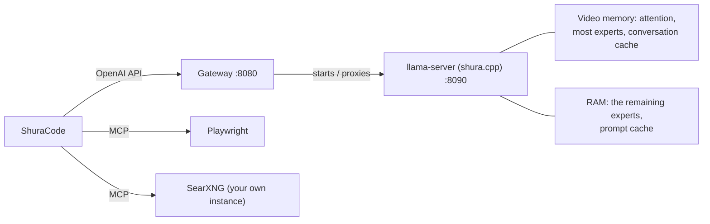

<div align="center">

<picture>
  <source media="(prefers-color-scheme: dark)" srcset="assets/logo-wordmark-dark.png">
  
</picture>

### A fully local AI assistant for code on a regular consumer gaming PC, and the PC stays yours

[](LICENSE)

-76B900)

[](https://github.com/hikkian/shura/actions/workflows/ci.yml)

English · [Русский](README.ru.md)

</div>

---

> *Shura* (شورى) is Arabic for "consultation, council". In a Mixture-of-Experts model every token is
> decided by a council: a router consults a few of its many experts. This project seats that council on
> a regular gaming PC without taking the PC away from its owner.

## What is Shura

Shura runs a Mixture-of-Experts language model on a regular consumer gaming PC and puts a coding agent
on top of it. There is no cloud and no subscription. Your code and your conversations stay on the machine.

It is the same PC you work on, so Shura splits it into two spaces:

- **Yours.** A guaranteed share of video memory and RAM that the model cannot take. The browser, video,
  a call and the editor live here.
- **The AI server.** The model lives in its own space with hard limits and works on what is left.

Shura is made of four parts:

| Part | What it does | Where it lives |
|---|---|---|
| Engine | **shura.cpp**, our fork of llama.cpp. Runs the model on the GPU and keeps the experts that do not fit in system RAM | [hikkian/shura.cpp](https://github.com/hikkian/shura.cpp) |
| Gateway | Loads the model on the first request, unloads it when idle, keeps sessions in RAM, watches memory | this repository, [`gateway/`](gateway) |
| ShuraCode | The coding agent in the terminal, with a memory that lasts across sessions | [hikkian/shuracode](https://github.com/hikkian/shuracode) |
| "Two spaces" app | A small native window that shows both spaces live | working build, not published yet |


### Today, on the author's PC

One machine: AMD RX 7800 XT 16 GB, Ryzen 5 5600, 32 GB DDR4, Fedora 45 with KDE Plasma. State on 2026-11-24.

| | |
|---|---|
| Model | **Inkling 2 Mini** is the main model since 2026-11-24, with a 114,688-token window |
| Answer speed | about **36 tok/s** (36.0 on a short prompt, 35.7 with 28k tokens of context), no draft model yet |
| Prompt reading | about **1,000 tok/s** at 28k tokens (980 through the gateway) |
| Your share | at least **1.89 GiB of video memory stays free** with the model loaded; the AI server is capped at 13.5 of 15.98 GiB of video memory and at 20 GiB of RAM |
| Loading | 33 s from cold, 13.5 s when repeated; unloading takes 4.5 s and the video memory comes back |
| Agent | ShuraCode works with the model: it answered, edited a file so that its test passed, and read code (three smoke tasks) |


> [!IMPORTANT]
> These numbers come from **one machine** and from the **working build**. Most of it is not in the
> published `main` branch yet, and the numbers of the new model change every week.
> [What is published and what is not](#what-is-published-and-what-is-not) says exactly where each part is.

## What works today

**In the working build** (the author's machine, not installable by others yet):

- Inkling 2 Mini answers through the gateway and ShuraCode. Reasoning arrives as a separate stream and tool calls work.
- The model loads on demand and unloads when idle.
- The walls between the two spaces stand: a video-memory cap, a RAM cap, and protection for the memory of your programs.
- The "two spaces" app shows who holds what.

**In the published `main` branch** (installable today):

- The previous build on the **Tiel-Coder** model for NVIDIA cards on Linux: installer, gateway, the `shura` command and ShuraCode.
- A universal installer, `shura check` and `shura install`, for other hardware. It has not been run on real hardware other than the author's.

**Not there yet** (plans, see [Status and roadmap](#status-and-roadmap)):

- The AI server yielding in steps and going to sleep by itself.
- Giving video memory back on the fly with Inkling. The Tiel-Coder build can do it; for Inkling it is not connected yet.
- A draft model for Inkling, a 300k window, and two or three sessions at once.
- Images with Inkling. The first live configuration has no vision projector.
- The split and the app set up by the installer.


## Splitting the computer

One gaming PC becomes two. The border moves by pressure on resources: somebody else's video memory, RAM
and GPU load. It does not depend on the name of the program, so a game, a video editor and a browser are
treated the same way.

### What stands today (working build, since 2026-11-24)

- **Video memory.** The AI server runs in its own control group with a cap of 13.5 GiB out of 15.98.
  The rest belongs to the desktop.
- **RAM.** The AI server is capped at 20 GiB. 8 GiB of your programs' memory is protected: when memory is
  short, the system takes it from the AI first.
- **CPU and disk.** The AI server has a lower weight than your programs.
- **Measured.** An allocation above the video-memory cap is refused in 18 ms and the program keeps
  running. The model is not slower inside the group: 24.4 against 24.2 tok/s for answers and 1,054
  against 1,055 tok/s for prompt reading at 28k tokens. The test ran in a different configuration
  from the live one, so compare the pair, not the level.
- **Reversible.** These are user-level settings and one command removes them. The video-memory cap has to
  be set again after a reboot; making it permanent needs one system setting with `sudo`.


### What the first experiments showed

- **The first cap was wrong.** It was 14.48 GiB: the card minus 1.5 GiB. That left 1.5 GiB for the whole
  desktop, not 1.5 GiB free. The window manager could not allocate a buffer and window switching
  broke. The cap is now the card minus what the desktop uses at its peak and minus another 1.5 GiB.
- **The cap is a ceiling, not an eviction.** Lowering it below what is already taken frees nothing. So
  the model has to give memory back itself, and the cap follows it down. The Tiel-Coder build has such a
  valve. For Inkling it is not connected yet, and the desktop is protected by the wall and by a fixed
  1.5 GiB reserve in the gateway.
- **Memory walls do not protect GPU time.** We played a video and held a call next to a working model,
  three clean runs each. In three of the six runs 145 to 299 frames out of about 2,220 (6–14 %) were
  shown more than 25 ms late. In the other three it was 4–5 frames, and without the model never more
  than 4. The split does not change this. Sharing GPU time is the next step. Until it is measured, this
  README does not claim that the desktop stays smooth.


### What is planned

The AI server will yield in steps and come back by itself:

| Step | What the AI server does |
|---|---|
| Full | uses its whole share |
| Slower | moves part of the experts from video memory to RAM |
| Minimum share | keeps the core of the model and the conversation; slow, but without a pause |
| Sleep | leaves video memory; the conversation waits in RAM, like a background browser tab |
| Wake | returns by itself when the pressure is gone, or at once on your request |

The rule for the speed floor: under load the target is at least 10 tok/s, the edge is 7, and below 7 the
model sleeps. It gives memory away fast and takes it back slowly. None of this is built for Inkling yet.


### The app

"Shura: two spaces" is one native binary of about 5 MiB. It shows two pairs of vessels, yours and Shura's,
for video memory and for RAM, with the line of what is always yours, the last hour as a chart, the
heaviest programs and the day's SSD writes. The interface is in English or Russian by system locale.
Idle, it takes 0.61 % of one CPU core and 27.5 MiB of RAM. It runs on the author's machine and is not
published. The "step" indicator waits for a gateway change that is written but not switched on.


## The model and the engine

**Model.** [Inkling 2 Mini](https://huggingface.co/thinkingmachines/Inkling-2-Mini) by Thinking Machines
is a 26B Mixture-of-Experts model whose middle layers run in a loop. We use the `UD-Q3_K_XL` GGUF from
[Unsloth](https://huggingface.co/unsloth/Inkling-2-Mini-GGUF), about 13 GiB. The experts of six layers
are computed from system RAM and the rest of the model is in video memory. The conversation cache is
stored at one precision for all tokens.

**Why the window is 114,688 tokens.** Video memory use grows by about 9 KiB per token of context. With a
262k window only 0.43 GiB would stay free, which breaks the 1.5 GiB rule for the desktop. A longer window
needs a different memory layout, and that work is in progress.

**Engine.** [shura.cpp](https://github.com/hikkian/shura.cpp) 1.0 is public. It is llama.cpp plus the
parts for sharing a card with a desktop: a live-resized expert cache, a video-memory governor, pause and
resume, and a 262k context for the previous model. The Inkling work sits on top of it in a working
branch: our own attention kernel and expert kernels for AMD cards. That branch is not published.

**Correctness.** A new engine build goes live only after a check against a reference build. The live
Inkling build matches its reference bit for bit: the same perplexity on English, Russian and code. Against
the build before kernel fusion the KL divergence is 0.0026 on ordinary tokens (0.0118 if the control
tokens of the chat template are counted, where the top-20 approximation inflates it). No agentic
benchmark has been run on Inkling yet.


### Where the speed is going

The speed goal is the ceiling of the card without loss of quality. The last column is the goal for the
finished profile. It is a goal, not a promise, and not the place to stop.

| | 2026-11-23, morning | Live configuration | Goal for the finished profile |
|---|---:|---:|---:|
| Prompt reading at 28k, tok/s | 187 | about 1,000 | 2,000 |
| Answer, short context, tok/s | 25.8 | 36 | 55 |
| Answer at 100k, tok/s | | not measured in this configuration | 40 |
| Answer at 300k, tok/s | | no run yet (the window is 114,688) | 30 |

- **Prompt reading.** On the test stand the best result so far is 1,776 tok/s at 28k. Our own forecast
  for the remaining steps ends between 2,400 and 2,950 tok/s, and 3,000 is the upper edge. The first two
  steps gave less than predicted: 62 ms per 1,000 tokens instead of 84–121.
- **Answers.** A layer visit now launches 48 to 80 small GPU kernels. The plan is to merge them into 15
  to 22. The calculated gain is 2.6 to 4.2 ms per token; it is a calculation, not a measurement. After
  that: experts that miss the card are read by the GPU straight from RAM instead of being computed on
  the CPU, and then a draft model.
- **Calculated ceiling** for this card: 63–83 tok/s for answers on a short context without drafts, and
  2,170–2,700 tok/s for prompt reading at 28k.


Design and endpoints of the gateway: [docs/ARCHITECTURE.md](docs/ARCHITECTURE.md). The engine: the
[shura.cpp README](https://github.com/hikkian/shura.cpp#readme).



## Quick start

> [!NOTE]
> What installs today is the **previous build**: Tiel-Coder on an NVIDIA card. The Inkling build, the
> split and the app are not in the installer yet.

On Fedora, Ubuntu/Debian or Arch with an NVIDIA GPU and its driver installed:

```bash
curl -fsSL https://raw.githubusercontent.com/hikkian/shura/main/setup.sh | bash
# or: git clone https://github.com/hikkian/shura.git && cd shura && ./setup.sh
```

The installer picks the Tiel-Coder quant that fits your RAM and video memory, builds the engine for your
GPU, measures a few layouts on your card and installs the gateway, ShuraCode and the `shura` command. It
asks before each `sudo` step. It needs at least 16 GB of RAM and 30–45 GB of free disk space. Options
and the list of everything it changes: [docs/INSTALLER.md](docs/INSTALLER.md). Manual setup:
[docs/INSTALL.md](docs/INSTALL.md).

On any other machine, look before you install:

```bash
git clone https://github.com/hikkian/shura && cd shura
./scripts/shura check             # what your machine can run (installs nothing, sends nothing)
./scripts/shura install --dry-run # what would be downloaded and how much disk it needs
./scripts/shura install           # download, test and set up
```

To build the engine for an AMD card yourself, follow the
[shura.cpp README](https://github.com/hikkian/shura.cpp#readme).


### Daily use

```
shura           # open ShuraCode in the current folder; the model starts loading in the background
shura status    # model state, free RAM and video memory
shura warm      # load the model now          shura unload   # free RAM and video memory now
shura off / on  # disable / enable the AI     shura logs     # follow logs
```

The model unloads itself after 30 idle minutes. **ShuraCode** has a permanent memory shared by all
sessions, the commands `/remember` `/forget` `/memory` `/test` `/commit`, and a read-only **Plan** mode
next to **Build**. It is our layer on top of the OpenCode engine.


## Will it run on my computer?

Only two machines have run Shura for real, and both are the author's.

| Machine | Build | State |
|---|---|---|
| AMD RX 7800 XT 16 GB + 32 GB RAM, Linux | working build (Inkling 2 Mini, split) | runs on the author's machine; not installable yet |
| The same machine | Tiel-Coder on shura.cpp 1.0 | was the live configuration from 2026-11-15 to 2026-11-24; the engine is public |
| NVIDIA RTX 4070 SUPER 12 GB + 32 GB RAM, Linux | `main`, `setup.sh` | verified on the author's previous card (2026-09) |
| Other NVIDIA cards on Linux | `main`, `setup.sh` | unverified; the plan comes from a model fitted to one machine |
| Other AMD cards, Intel, Apple Silicon, Windows, CPU only | `main`, `shura install` | unverified on real hardware; unit tests and CI only |

- **The video-memory wall** needs a Linux kernel with the `dmem` control group (6.14 or newer) and a
  driver that reports to it. Where it is missing, the plan is to keep the RAM and CPU split and guard
  video memory with the gateway's reserve.
- **Speed.** The installer does not promise a number before the first run. It measures on your machine.
- **If it did not work**, see [docs/TROUBLESHOOTING.md](docs/TROUBLESHOOTING.md).
- How the choice is made: [docs/HARDWARE.md](docs/HARDWARE.md).


## Status and roadmap

### What is published and what is not

| | Published `main` | Public, outside `main` | Working build only |
|---|---|---|---|
| Model | Tiel-Coder-35B-A3B | | Inkling 2 Mini; Tiel-Coder stays as a second model |
| Engine | the thecodacus `perf` fork of llama.cpp at a pinned commit, with our patches from `patches/`; NVIDIA/CUDA | **shura.cpp 1.0** (release `shura-v1.0.0`, 2026-11-15) | the Inkling branch of shura.cpp |
| Gateway and installer | on-demand loading, idle unload, saving that spares the SSD, `setup.sh`, `shura check` / `install` | branch [`engine-1.0`](https://github.com/hikkian/shura/tree/engine-1.0): gateway, installer and tools for shura.cpp 1.0 | the Inkling profile; step and speed fields for the app, on a branch |
| Split | | | walls since 2026-11-24 |
| App | | | installed on the author's machine |
| Agent | [ShuraCode](https://github.com/hikkian/shuracode), its own repository | | |


### Roadmap

| Stage | What | Done when |
|---|---|---|
| 1. Engine on Inkling (now) | attention, token output, memory layout and expert cache, draft model, gateway, final profile | the profile reaches the speed goals at every depth and passes the correctness checks |
| 2. Two computers | video-memory valve, steps, sleep, comfort measurements | the desktop is smooth by named measures under load; memory is given and returned in a measured time; a conversation survives sleep |
| 3. Several sessions | a shared beginning for sessions, silent sessions kept in RAM | two or three sessions answer at once, each with 300k and at least 20 tok/s |
| 4. Growth | the base weights are never rewritten; small addressed corrections go on top, each with its origin recorded and each removable | the first edition passes the exam and can be removed bit for bit |
| 5. Growth switched on | memory and rules through gates, a calibrated exam, a personal layer that stays local | "your Shura against the original" improves with no losses above the tolerance |
| 6. Publication | the Inkling engine branch, the improved model without personal data, a post | on the author's word |

The growth system is called **Bayt al-Hikma**, the House of Wisdom. The idea in one line: the model
changes, the experience stays yours. Growth starts with text (a fact goes to memory, a repeated habit
becomes a rule) and moves into weights only when text is measured not to be enough. Nothing of this has
been shown on Inkling yet.


### What this README does not claim

- Numbers on hardware other than the author's.
- A smooth desktop as a measured fact. The first experiment did not confirm it.
- Anything about answer quality on Inkling beyond the correctness checks above.
- A 300k window or parallel sessions on Inkling. There has been no run.
- A side-by-side number against upstream llama.cpp of the same day.

## Previous build: Tiel-Coder

Before Inkling the main model was
[Tiel-Coder-35B-A3B](https://huggingface.co/peculiar-ragdoll/Tiel-Coder-35B-A3B-GGUF-MTP). These are the
last complete measurements of that build. They are kept as a record and are not updated. The method,
the full tables and the ideas that did not work are in [docs/BENCHMARKS.md](docs/BENCHMARKS.md).

| When and where | Result |
|---|---|
| 2026-11, shura.cpp 1.0, RX 7800 XT 16 GB, one mode with a 262,144-token window | 58.9 tok/s with 100k tokens of context, 44.6 with 200k; at least 1.72 GiB of video memory free |
| 2026-10, the earlier fork, same PC | 75.4 tok/s on a short prompt, 70.7 at 28k, 48.6 at 100k |
| 2026-10, the desktop takes +400 MiB of video memory during an answer | free video memory is back above 1.5 GiB in 0.24 s and the answer keeps streaming |
| 2026-10, back to a 98.5k-token session | 0.54 s from a RAM snapshot instead of 156 s of re-reading |
| 2026-10, ShuraCode on the dev split of our agentic task set | 73 of 111 runs solved (66 %) |
| 2026-09, NVIDIA RTX 4070 SUPER 12 GB | 38.6–39.2 tok/s with 187k tokens of context |


## How to help

1. Run `./scripts/shura check` and see whether the plan makes sense for your machine.
2. Run `./scripts/shura install --dry-run`, then `./scripts/shura install`.
3. Open a [hardware report](https://github.com/hikkian/shura/issues/new?template=hardware_report.md)
   whichever way it went. `./scripts/shura report --issue` prints a pre-filled link. The report has no
   names, paths or IDs, and nothing is sent until you press the button on GitHub.

A failed install is as useful as a successful one. To add hardware, a model or a backend:
[CONTRIBUTING-hardware.md](CONTRIBUTING-hardware.md).

The reasons behind the decisions and the progress are on the blog:
[hikkian.github.io/blog](https://hikkian.github.io/blog/).


## Documentation

| | |
|---|---|
| [ARCHITECTURE.md](docs/ARCHITECTURE.md) | Gateway state machine, endpoints, session cache and SSD wear |
| [INSTALLER.md](docs/INSTALLER.md) | What `setup.sh` and `shura install` do, what they change, uninstall |
| [INSTALL.md](docs/INSTALL.md) | Manual step-by-step setup |
| [HARDWARE.md](docs/HARDWARE.md) | How a model and settings are chosen for your hardware |
| [BENCHMARKS.md](docs/BENCHMARKS.md) | The September 2026 measurements on the 12 GB card |
| [TURBOQUANT-FIX.md](docs/TURBOQUANT-FIX.md) | A crash and silent corruption in the compressed cache, and the fix |
| [TROUBLESHOOTING.md](docs/TROUBLESHOOTING.md) | Known failure modes and their fixes |
| [SECURITY.md](SECURITY.md) | Threat model: localhost-only services, no auth, what not to expose |

These pages describe the published `main` branch, that is, the Tiel-Coder build.

## Acknowledgements

- [ggml-org/llama.cpp](https://github.com/ggml-org/llama.cpp), the foundation of everything here, and
  its contributors who added Inkling 2 support upstream
- [Thinking Machines](https://huggingface.co/thinkingmachines/Inkling-2-Mini) for Inkling 2 Mini and
  [Unsloth](https://huggingface.co/unsloth/Inkling-2-Mini-GGUF) for the GGUF quants
- The [thecodacus/llama.cpp](https://github.com/thecodacus/llama.cpp) `perf` fork (MoE expert cache,
  TurboQuant), where this project started, and [TheTom/llama-cpp-turboquant](https://github.com/TheTom/llama-cpp-turboquant)
- **wilky2005** for the TurboQuant fix ([thecodacus/llama.cpp#12](https://github.com/thecodacus/llama.cpp/pull/12))
- The authors of the upstream fix for persistent context checkpoints
  ([llama.cpp #25913](https://github.com/ggml-org/llama.cpp/issues/25913),
  [PR #26004](https://github.com/ggml-org/llama.cpp/pull/26004))
- [Tiel-Coder-35B-A3B-MTP](https://huggingface.co/peculiar-ragdoll/Tiel-Coder-35B-A3B-GGUF-MTP) by peculiar-ragdoll
- The open Basalt engine (MIT), whose decode path we read for ideas
- [OpenCode](https://github.com/anomalyco/opencode), [SearXNG](https://github.com/searxng/searxng),
  [Playwright MCP](https://github.com/microsoft/playwright-mcp)


## License

[MIT](LICENSE) for everything in this repository. The patches in `patches/` are derived from llama.cpp (MIT).
Model weights are not included and are covered by their own licenses.
