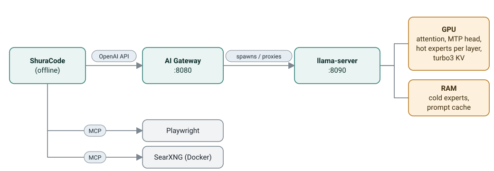

<div align="center">

<picture>
  <source media="(prefers-color-scheme: dark)" srcset="assets/logo-wordmark-dark.png">
  
</picture>

### A 35B coding model on one gaming GPU, on a PC you keep using

[](LICENSE)

-76B900)

[](https://github.com/hikkian/shura/actions/workflows/ci.yml)

English · [Русский](README.ru.md)

</div>

---

> *Shura* (شورى) is Arabic for "consultation, council". In a Mixture-of-Experts model every token is
> decided by a council: a router consults 8 of 256 experts. This project is about seating that council
> on modest hardware.

## What is Shura

A 35B Mixture-of-Experts coding model runs on an ordinary home PC with one gaming graphics card. No
server, no cloud. And while the model works, the computer stays yours: the browser, video, a call and
the IDE keep running on the same GPU without stutter.

How that is done, in one breath (the working build; the [Status](#status-preparing-10) section says what is in
`main` today): the model's **hot experts live in VRAM** and the rest are computed from
system RAM; a **governor inside the inference server** watches free VRAM every 200 ms and gives memory
back to the desktop the moment the desktop needs it; when it has to stop, it **checkpoints and continues
the same answer** after a restart; the **KV cache is compressed** so a 200k-token window fits; the
model's own **MTP head** drafts tokens; a small **gateway** loads the model on demand, keeps sessions in
RAM and protects your SSD; **ShuraCode**, an offline coding agent, sits on top. The engine is our fork of
llama.cpp, [hikkian/llama.cpp-shura](https://github.com/hikkian/llama.cpp-shura).

| At a glance (working build, measured 2026-10-24/25) | |
|---|---|
| Models | [Tiel-Coder-35B-A3B](https://huggingface.co/peculiar-ragdoll/Tiel-Coder-35B-A3B-GGUF-MTP) (APEX-I-MiniPlus quant, ~14 GB, with its MTP head); Occamy-1.0 as the second model |
| Hardware | AMD RX 7800 XT 16 GB · Ryzen 5 5600 · 32 GB DDR4-3200 · Fedora 44, KDE on Wayland · ROCm 7.2.4 |
| Context | 200k window; decode **75 tok/s** on a short prompt, **71** at 28k, **49** at 100k filled (Tiel) |
| The desktop comes first | the model keeps 1.5 GiB of VRAM free for the desktop; when the desktop grabs +400 MiB mid-answer, the model gives it back in **0.24 s** and keeps streaming |
| Coming back to a session | a 100k-token session is restored in **0.5 s** instead of 156 s of re-reading |
| Stability | memory flat (0.01 GiB/h) and 0 GPU page faults over 170 long requests up to 180k tokens |
| Everything offline | inference, web search, browser automation |

> [!IMPORTANT]
> These numbers come from **one machine** and from the **working build** that is being prepared for 1.0
> (see [Status](#status-preparing-10)). Other GPUs, CPUs and memory speeds will differ, and the setup
> needs re-tuning there. Raw measurements and the method are published with the 1.0 benchmark set.

## Status: preparing 1.0

This README describes the project as it is measured today. Not all of it is in the published `main`
branch yet. To be exact:

| | In the published `main` today | Measured on the working build, lands in 1.0 |
|---|---|---|
| Engine | thecodacus `perf` fork of llama.cpp with the MoE expert cache and TurboQuant KV, plus our patches (TurboQuant fix, persistent slot checkpoints); **NVIDIA/CUDA** | our fork [llama.cpp-shura](https://github.com/hikkian/llama.cpp-shura) built with **ROCm/HIP for AMD**; the VRAM governor, elastic expert cache, pause-and-continue, page-fault fix in the MoE matmul path (these patches are in the working branch, not yet in the public fork) |
| Memory | VRAM guard that parks the session in RAM under pressure (opt-in); prompt cache in RAM; the session is written to disk only when the model unloads | governor keeps ≥ 1.5 GiB free by construction; RAM budget that counts honest free memory and loads the model without evicting your browser from the page cache; lighter fallback layouts instead of refusing to load |
| Sessions | slot save/restore with persistent context checkpoints (opt-in) | checkpoint on pause, restart, and the **same answer continues**; automatic switch between a short-context and a 200k layout keeping the slot |
| Gateway, installer, ShuraCode | on-demand loading, idle unload, SSD-wear-aware saving, hardware planner, `shura` CLI | the same, plus desk-need signals (full-screen app, game) that raise the VRAM reserve before the desktop asks |
| Numbers | 2026-09 on an RTX 4070 SUPER 12 GB: 38–39 tok/s at 187k filled context ([docs/BENCHMARKS.md](docs/BENCHMARKS.md)) | 2026-10 on an RX 7800 XT 16 GB: the table above and [Results](#results) |

What this README does **not** claim: a side-by-side number against upstream llama.cpp of the same day
(that measurement is planned for the 1.0 benchmark set), desktop smoothness as a number (the earlier
metric turned out to be insensitive; a better one is in the works), and anything about hardware we have
not run ourselves.

## Results

All numbers: working build, one machine (RX 7800 XT 16 GB, Ryzen 5 5600, 32 GB DDR4, ROCm 7.2.4), with a
live KDE desktop holding 1.3–1.6 GiB of VRAM during the runs. Speeds are server-side, wall-clock tokens
per second of real requests through the gateway (not `llama-bench`), averaged over three alternating
pairs against the previous build; MTP speculative decoding is on in the short layout.

**Speed** (2026-10-24)

| | short prompt | 28k filled | 100k filled |
|---|---:|---:|---:|
| Tiel-Coder-35B-A3B, decode tok/s | **75.4** | **70.7** | **48.6** |
| Occamy-1.0, decode tok/s | 64.4 | 62.2 | 45–47 |

The 100k numbers come from the long-context layout (200k window, more experts on the CPU, no MTP:
measured, speculative decoding does not pay off there). Switching between the short and the long layout
keeps the session and takes 20–28 s.

**The desktop comes first** (2026-10-25)

| Event during an answer | What happened |
|---|---|
| Desktop takes +400 MiB of VRAM while the model decodes | free VRAM is back above 1.5 GiB after **0.24 s**; the longest gap between tokens was 51 ms |
| The same during a 100k-token prefill | back above 1.5 GiB after **0.29 s**, prefill continues |
| Desktop takes more than the model can give back | the model checkpoints its slot (0.6 s), exits, is restarted by the gateway in a lighter layout, restores the slot (22 ms) and **continues the same answer** |
| 44-minute soak: 171 requests from 0.2k to 28k tokens plus 25 desktop jumps of 100–450 MiB | 15 cache shrinks, 12 regrowths, no pause needed, the server's buffer pool never grew after warm-up |

The mechanism is an elastic expert cache: the hot experts in VRAM are copies of experts that also live in
RAM, so giving them back costs speed, never correctness. The governor runs inside `llama-server`, polls
the card every 200 ms and resizes the cache between compute steps.

**Sessions survive** (2026-10-17, 2026-10-25)

| | Time |
|---|---:|
| Back to a 98.5k-token session from a RAM snapshot | **0.54 s** (0.63 s from NVMe) |
| The same without a snapshot: re-reading the context | 156 s |
| Pause mid-answer, restart, restore, continue | checkpoint 0.6 s, restore 22 ms, no duplicated or missing text at the seam |

**It runs for days** (2026-10-24)

| | Result |
|---|---|
| Host memory of `llama-server` under a steady replay (ROCm 7.2.4) | heap growth 0.01 GiB/h; on ROCm 7.1.1 the same run grew 4.5 GiB/h, which is why the build moved to 7.2.4 |
| 40-minute long-session hammer: 170 requests, prompts up to 180,300 tokens, cache resizes on every request | 0 GPU page faults, 0 watchdog stops, 0 errors. An out-of-bounds read in the MoE matmul path that caused page faults on long sessions was found and fixed on the way |

**The agent** (2026-10-24)

ShuraCode on Tiel, run the way the product runs (serve mode through the gateway, short layout), on the
dev split of our agentic task set: **73 of 111 runs solved (66 %)**: bug fixes 86 %, tests-only tasks
100 %, implement 41 %, refactor 36 %. The harness is in [`bench/agentic-eval`](bench/agentic-eval); the task set used
here (224 verifiable tasks in 56 families) is published with 1.0.

**Quality gate.** Every change to kernels or layouts is accepted only if the KL divergence of the output
distribution to the reference layout stays within the gate (0.0385 on a fixed corpus) and the top-1 token
agreement does not drop; levers that failed the gate are off. The method and the full tables are
published with the 1.0 benchmark set; the September measurements on the 12 GB card are in
[docs/BENCHMARKS.md](docs/BENCHMARKS.md).

## How it works



The experts of the first layers stay in system RAM and the CPU computes the cold ones on 6 threads; the
most-routed experts of every layer sit in VRAM, chosen by a routing profile traced from generated tokens,
and the two halves are merged exactly, so the output is the same as without the cache. The KV cache is
compressed (TurboQuant) so that a 200k window fits next to the weights. The model's own MTP head drafts
tokens for speculative decoding. The gateway starts the model on demand, survives crashes, switches
text/vision automatically, keeps the prompt cache in RAM and parks the session in RAM when the desktop
needs the VRAM. In the working build the size of the expert cache is no longer fixed: the governor in
`llama-server` sizes it to whatever VRAM the desktop is not using, down to zero (see
[Status](#status-preparing-10)). Design and endpoints: **[docs/ARCHITECTURE.md](docs/ARCHITECTURE.md)**.

## What we learned

- **A fixed VRAM split cannot be both fast and safe.** The desktop's GPU memory swings by hundreds of
  MiB (calls, video, the lock screen, a new tab). The answer is not a bigger reserve but a cache that
  shrinks in a quarter of a second and grows back when the desktop is quiet.
- **The expert cache is the biggest lever, and too many slots fail silently.** Oversubscribed VRAM does
  not raise an error, it slows down run over run.
- **Prompt experts ≠ generation experts.** A routing profile must be traced from generated tokens.
- **TurboQuant is not a speedup by itself.** Its value is turning saved KV VRAM into more expert slots.
  It also needs [a fix](docs/TURBOQUANT-FIX.md) on head_dim-256 models.
- **Hybrid models need context checkpoints, and slot save/restore does not keep them.** Without them any
  change in the prompt prefix forces a full re-read.
- **`MemAvailable` lies about your browser.** Loading 14 GB of weights through the page cache pushes the
  browser into swap while the kernel still reports plenty of "available" memory. The model has to load
  without touching the page cache and count only honest free memory.
- **Speculative decoding does not always pay.** With many experts on the CPU, verifying a draft costs
  almost as much as generating the tokens; in the long-context layout MTP is off, by measurement.
- **A GPU page fault is usually a bug, not the driver.** Ours was an out-of-bounds read in the MoE
  matmul path, visible only on long, growing sessions.

<details>
<summary><b>Ideas that did not work here</b> (all measured)</summary>

All experts on CPU with a large expert cache · n-gram drafting on top of MTP · fusing the small kernels of
a decode step (a few percent at most) · a separate 100k "normal" profile with more slots · more than 24
expert slots at 200k context on the 12 GB card · Vulkan for this stack (the compressed KV cache produced
garbage and MTP accepted nothing). Details: [docs/BENCHMARKS.md](docs/BENCHMARKS.md).

</details>

## Quick start

On Fedora, Ubuntu/Debian or Arch with an NVIDIA GPU and its driver installed (the published installer
path; the AMD/ROCm path used for the numbers above arrives with 1.0):

```bash
curl -fsSL https://raw.githubusercontent.com/hikkian/shura/main/setup.sh | bash
# or: git clone https://github.com/hikkian/shura.git && cd shura && ./setup.sh
```

The installer picks the Tiel-Coder quant that fits your RAM and VRAM, builds llama.cpp for your GPU,
measures a few layouts on your card and installs everything. It asks before each `sudo` step. Options
(`--quick`, `--quant`, `--model`, `--no-search`) and the list of everything it changes:
**[docs/INSTALLER.md](docs/INSTALLER.md)**. Manual setup: **[docs/INSTALL.md](docs/INSTALL.md)**.

## Daily use

Everything starts with the desktop session; nothing needs to be launched by hand.

- **App menu → Shura.** Pick a project folder and ShuraCode opens there in its own window. Right-click the
  icon for *Load model now* / *Unload model*. Works with one of the supported terminals
  (`SHURA_TERMINAL` chooses one; only Ghostty has been tested).
- **Terminal:** `cd` into a project and type `shura`. The model starts loading in the background.

```
shura status    # model state, free RAM/VRAM, idle timer
shura warm      # load the model now          shura unload   # free RAM/VRAM now
shura off / on  # disable / enable the AI     shura logs     # follow logs
shura window    # new Shura window for the current folder
```

The model unloads itself after 30 idle minutes; the last long session is saved and restored on the next
start.

**ShuraCode** is the coding agent: permanent memory shared by all sessions, the commands `/remember`
`/forget` `/memory` `/test` `/commit`, a read-only **Plan** mode next to **Build** (Tab), and a live model
status in the footer. It is our customization layer on top of the OpenCode engine, in its own repository:
**[hikkian/shuracode](https://github.com/hikkian/shuracode)**; the installer sets it up.

## Will it run on my computer?

- **Backend.** By default the installer uses Vulkan (it works on NVIDIA, AMD and Intel) and falls back to the CPU if that
  fails. Another backend can be chosen with `--backend`.
- **Memory.** The catalog model (35B-A3B, MoE) needs about 20 GiB of memory on the CPU alone. A machine with 16 GB of RAM and no
  graphics card will not fit, and the installer says why. A graphics card with 6 GB of memory and 8 GB of RAM will not fit
  either. A graphics card with 8 GB of memory and 32 GB of RAM fits: some layers stay in RAM (a hybrid layout).
- **Speed.** Before the first run the installer does not promise a number. The prediction is an estimate and can differ a
  lot from reality; for MoE models on Vulkan it is not calibrated yet. Trust the measurement on your machine, which the
  installer runs itself.
- **If it did not work**, see [docs/TROUBLESHOOTING.md](docs/TROUBLESHOOTING.md).
- **Other machines.** What has been verified is in the table below; how to join the pilot programme:
  [CONTRIBUTING-hardware.md](CONTRIBUTING-hardware.md).

## Run it on your hardware

Shura chooses the model and the settings from what your machine can do, not from its brand: how fast its memory
really is (measured), how much of it there is, what the GPU has, and which backend actually works.

```bash
git clone https://github.com/hikkian/shura && cd shura
./scripts/shura check             # what your machine can run and how fast (installs nothing, sends nothing)
./scripts/shura install --dry-run # what would be downloaded, how much disk it needs (downloads nothing)
./scripts/shura install           # download, test and set up; then `shura start` / `shura stop`
./scripts/shura report --issue    # an anonymous report for a GitHub issue: helps everyone with your hardware
```

On Windows use `scripts\shura.cmd` (or `py installer\universal\cli.py`). Windows cannot measure RAM speed without a compiler: add `--ram-gbs 40` (dual-channel DDR4-3200; about 80 for DDR5-6000). NVIDIA on Linux gets the fast tier (our
CUDA fork) through `setup.sh`; `shura install` points you to it. Every other machine is installed by `shura install`
itself, without compiling anything and without root.

`shura install` is built so that a bad day costs you nothing: it asks before it downloads; it checks the free disk space
first; a dropped download **resumes**; every file is verified (size and SHA-256); it runs the real server with the planned
settings to **prove** they work; if the machine runs out of memory it plans again with more room left free and retries; and
if nothing works it leaves a report without personal data and keeps the downloads, so the next run does not start over.
`shura uninstall` removes the Shura home folder (engines, models, logs, state). The `setup.sh` install also writes files outside it ([INSTALLER.md](docs/INSTALLER.md)); uninstall leaves those.

> [!NOTE]
> Where it can run (Vulkan on Linux, Metal on Apple Silicon, CUDA on Windows with NVIDIA), `shura install` also tries a
> **third-party** llama.cpp fork with a turbo KV cache, an expert cache and MTP
> ([TheTom/llama-cpp-turboquant](https://github.com/TheTom/llama-cpp-turboquant), pinned release, archive checked against a
> SHA-256 recorded in this repository). It measures it against upstream llama.cpp on your machine and keeps the fastest. Each vendor's own stack (ROCm on AMD, CUDA on NVIDIA, SYCL on Intel, Metal on Apple) stays the main
> engine unless another is 10% faster on your machine. `shura install --no-turbo` never uses the third-party build.

- **Classes by resources, not by device type:** a GPU with system RAM, unified memory (Apple), or a CPU-only machine.
  CPU-only does not mean small models: a many-channel server can run models no 12 GB card can hold.
- **Backends:** NVIDIA (CUDA, Vulkan), AMD (ROCm or Vulkan, whichever measures faster), Intel (SYCL, Vulkan, OpenVINO),
  Apple (Metal), or the CPU. The prebuilt llama.cpp builds are used, nothing is compiled on your machine.

### What is verified, and what is not

> [!WARNING]
> **Two machines have run Shura for real, both the author's:** an RX 7800 XT 16 GB (today, the working build) and an
> RTX 4070 SUPER 12 GB (until 2026-10). Everything else below is written, tested in software and believed to work, but
> **nobody has run it on that hardware yet**. You may be the first, and your result is the most useful thing you can send.

| Your machine | How it is installed | State |
|---|---|---|
| AMD RX 7800 XT 16 GB, Linux, ROCm | working build (1.0) | **Verified** on the author's machine; not yet in the published installer |
| NVIDIA, Linux, 12 GB VRAM + 32 GB RAM | `setup.sh` (CUDA fork) | **Verified** on the author's previous card (2026-09) |
| NVIDIA, Linux, other sizes (8, 16, 24 GB; 16 GB RAM) | `setup.sh` | **Unverified.** The plan is computed from a model fitted to one machine |
| Other AMD cards (ROCm or Vulkan), Intel (SYCL, Vulkan, OpenVINO) | `shura install` | **Unverified on real GPUs** |
| Apple Silicon (Metal) | `shura install` | **Unverified** |
| Windows (any GPU, or CPU) | `shura install` | **Unverified**; only unit tests and CI runners |
| CPU-only, including many-channel servers | `shura install` | **Unverified**; speed predictions are least certain here |

What is checked automatically on every commit (CI): unit tests on Linux, macOS and Windows; the real llama.cpp build
is downloaded and run on a 19 MB model (the CPU build on Linux and Windows, the Metal build on macOS, inside a CI virtual machine); the Vulkan build runs on a software driver (experimental). The flags `shura install` passes to `llama-server` were checked against the real `--help` of the pinned release (b11301); no CI step repeats that check.

What **no one has checked**: a real GPU other than the author's two; loading the real model on other hardware; the speed
predictions (estimates, fitted to one machine, shown as a range, and the plan is tested by really starting the server);
Windows start/stop of the server; a load slower than 15 minutes (the installer gives up waiting).

### Help us check it

1. `./scripts/shura check` and look at the plan: does it make sense for your machine?
2. `./scripts/shura install --dry-run`, then `./scripts/shura install`.
3. Open a **[Hardware report](https://github.com/hikkian/shura/issues/new?template=hardware_report.md)** issue whichever way
   it went. `./scripts/shura report --issue` prints a pre-filled link; the report has no names, paths or IDs and nothing is
   sent until you press the button on GitHub.
   - **It worked:** say the speed you really saw (tokens/s) and the context size. The report already has what we predicted;
     the gap between the two is how the predictions get fixed.
   - **It did not:** attach `logs/verify.log` from the Shura folder (`~/.local/share/shura`, `~/Library/Application
     Support/shura` or `%LOCALAPPDATA%\shura`) and say where it stopped. A failed install is as useful as a successful one.
   - **You fixed it yourself:** describe what was wrong and send the change.
4. A machine class moves from *unverified* to *verified* in the table above when a report with a real measurement arrives.

How the decision is made: **[docs/HARDWARE.md](docs/HARDWARE.md)**. To add your hardware, a model or a backend:
**[CONTRIBUTING-hardware.md](CONTRIBUTING-hardware.md)**.

## Tested environment and limits

> [!NOTE]
> Everything here was developed and tested on **one machine at a time**. Anything outside this list is supported by
> design but **untested**. Reports and fixes are welcome.

| | Today (working build) | Until 2026-10 (published `main`) |
|---|---|---|
| OS | Fedora 44, kernel 7.2, x86_64 | Fedora 44 |
| Desktop | KDE Plasma on Wayland | KDE Plasma on Wayland (earlier: GNOME Shell 50) |
| GPU / driver | AMD RX 7800 XT 16 GB, ROCm 7.2.4 (installed next to the system's 7.1.1) | NVIDIA RTX 4070 SUPER 12 GB, driver 615.71, CUDA 13.4 |
| CPU / RAM | AMD Ryzen 5 5600, 32 GB DDR4-3200 | the same |
| Software | ShuraCode 0.1 (OpenCode 1.18 engine), Python 3.14, Node 24 | the same, Docker 29 |

**What this is not:**
- It is a 35B-A3B-class model at 3–4 bits. Expect a capable local coding assistant, not a frontier model.
- Tested on Linux only. The expert cache, the governor and the compressed KV cache live in the CUDA/HIP backend of the
  fork; Intel and Apple get upstream llama.cpp without them.
- Not validated on other hardware: other distributions (the installer's package steps were checked in
  Ubuntu 24.04, Debian 12, Arch and Fedora 44 containers only; a full fresh install has not been run there), XFCE and
  tiling WMs, terminals other than Ghostty (dry-run only), the `kdialog`/`yad` dialogs, and GPUs other than the author's two.

<details>
<summary><b>Intel GPUs and other AMD cards: how to port Shura</b></summary>

AMD is now the author's main machine (ROCm/HIP), but only one card has been run. Other AMD cards should work with the
same build; please send a hardware report. Intel is not supported out of the box. You can port it yourself or with an AI
coding agent (ShuraCode can do this work too). Upstream llama.cpp already runs on Intel (SYCL, Vulkan). Two features
of the fork are missing there:

1. **Works today, slower:** build upstream llama.cpp for your backend and use the same layout ideas: the
   first layers' experts in RAM (`--n-cpu-moe`), `q8_0`/`q4_0` KV cache and MTP. The gateway, ShuraCode and
   the rest of this repository do not depend on the fork.
2. **Full speed:** port the fork's expert-cache and compressed-KV kernels to SYCL or Vulkan. Then
   re-run the benchmarks in `bench/` and the correctness probes, because silent output corruption is the
   failure mode to watch for (see [docs/TURBOQUANT-FIX.md](docs/TURBOQUANT-FIX.md)).

Pull requests with measured results on other cards are very welcome.

</details>

## Repository layout

```
setup.sh     one-command installer (distro packages, CUDA, build, model, auto-tune)
installer/   hardware planner, GGUF header reader, model download, auto-tune
tests/       installer and gateway unit tests + distro package test (containers)
gateway/     ai_gateway.py - on-demand llama-server manager + OpenAI-compatible proxy (stdlib only)
config/      example configs + agentic MoE routing profile for Tiel-Coder
patches/     patches for the llama.cpp fork (TurboQuant head_dim-256 fix, persistent slot checkpoints, ...)
scripts/     shura (daily CLI), build-llama.sh, install.sh, capture-moe-trace.sh
desktop/     app-menu launcher template
assets/      logo (light/dark), app icons, social preview, source artwork
bench/       agentic-eval task set and harness, deep-context benchmark, depth sweep, correctness probes
systemd/     user service unit
searxng/     private SearXNG settings template
docs/        benchmarks, architecture, harness comparison, TurboQuant fix, install, troubleshooting
```

## Documentation

| | |
|---|---|
| [BENCHMARKS.md](docs/BENCHMARKS.md) | The September measurements on the 12 GB card: build tuning, MTP, threads, routing profiles, prefill, dead ends |
| [ARCHITECTURE.md](docs/ARCHITECTURE.md) | Gateway state machine, endpoints, KV cache and SSD-wear design |
| [TURBOQUANT-FIX.md](docs/TURBOQUANT-FIX.md) | Why TurboQuant crashes or corrupts output on this model family, and the fix |
| [HARNESS-COMPARISON.md](docs/HARNESS-COMPARISON.md) | OpenCode vs Pi vs Pithagoras vs DeepSeek Harness, tested hands-on |
| [INSTALLER.md](docs/INSTALLER.md) | What `setup.sh` does, how it picks the quant and tunes, what it changes, uninstall |
| [INSTALL.md](docs/INSTALL.md) | Manual step-by-step setup and tuning for other GPUs |
| [TROUBLESHOOTING.md](docs/TROUBLESHOOTING.md) | Known failure modes and their fixes |
| [SECURITY.md](SECURITY.md) | Threat model: localhost-only services, no auth, what not to expose |

## Acknowledgements

- [ggml-org/llama.cpp](https://github.com/ggml-org/llama.cpp), the foundation of everything here, and the
  [thecodacus/llama.cpp](https://github.com/thecodacus/llama.cpp) `perf` fork (MoE expert cache, TurboQuant), from which
  [our fork](https://github.com/hikkian/llama.cpp-shura) descends
- **wilky2005** for the TurboQuant fix ([thecodacus/llama.cpp#12](https://github.com/thecodacus/llama.cpp/pull/12))
- The authors of the upstream fix for persistent context checkpoints
  ([llama.cpp #25913](https://github.com/ggml-org/llama.cpp/issues/25913),
  [PR #26004](https://github.com/ggml-org/llama.cpp/pull/26004)), which our implementation builds on
- [Tiel-Coder-35B-A3B-MTP](https://huggingface.co/peculiar-ragdoll/Tiel-Coder-35B-A3B-GGUF-MTP) by peculiar-ragdoll
- [OpenCode](https://github.com/anomalyco/opencode), [SearXNG](https://github.com/searxng/searxng),
  [Playwright MCP](https://github.com/microsoft/playwright-mcp)

## License

[MIT](LICENSE) for everything in this repository. The patches in `patches/` are derived from llama.cpp (MIT).
Model weights are not included and are covered by their own license.
