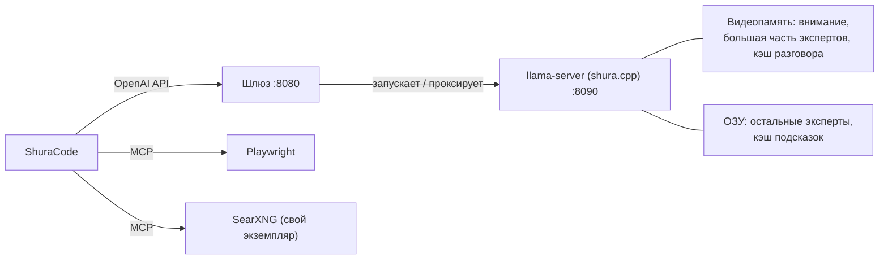

<div align="center">

<picture>
  <source media="(prefers-color-scheme: dark)" srcset="assets/logo-wordmark-dark.png">
  
</picture>

### Полностью локальный ИИ-помощник для кода на обычном игровом ПК, и компьютер остаётся вашим

[](LICENSE)

-76B900)

[](https://github.com/hikkian/shura/actions/workflows/ci.yml)

[English](README.md) · Русский

</div>

---

> *Шура* (شورى) по-арабски значит «совет, совещание». В модели Mixture-of-Experts каждый токен решает
> совет: маршрутизатор советуется с несколькими из множества экспертов. Этот проект о том, как посадить
> такой совет на обычный игровой ПК и не отобрать компьютер у его хозяина.

## Что такое Shura

Shura запускает языковую модель Mixture-of-Experts на обычном игровом ПК и ставит поверх неё агента
для программирования. Облака нет, подписки нет. Код и разговоры остаются на вашей машине.

Это тот же компьютер, за которым вы работаете. Поэтому Shura делит его на два пространства:

- **Ваше.** Гарантированная доля видеопамяти и ОЗУ, которую модель взять не может. Здесь живут браузер,
  видео, звонок и редактор.
- **ИИ-сервер.** Модель живёт в своём пространстве с жёсткими пределами и работает на том, что осталось.

Shura состоит из четырёх частей:

| Часть | Что делает | Где лежит |
|---|---|---|
| Движок | **shura.cpp**, наш форк llama.cpp. Считает модель на видеокарте и держит в ОЗУ тех экспертов, которые в видеопамять не поместились | [hikkian/shura.cpp](https://github.com/hikkian/shura.cpp) |
| Шлюз | Загружает модель по первому запросу, выгружает в простое, держит сессии в ОЗУ, следит за памятью | этот репозиторий, [`gateway/`](gateway) |
| ShuraCode | Агент для кода в терминале с памятью, которая сохраняется между сессиями | [hikkian/shuracode](https://github.com/hikkian/shuracode) |
| Приложение «Два пространства» | Небольшое окно, которое показывает обе части компьютера вживую | рабочая сборка, пока не опубликовано |


### Сегодня на компьютере автора

Одна машина: AMD RX 7800 XT 16 ГБ, Ryzen 5 5600, 32 ГБ DDR4, Fedora 45 с KDE Plasma. Состояние на 24.11.2026.

| | |
|---|---|
| Модель | **Inkling 2 Mini** основная с 24.11.2026, окно 114 688 токенов |
| Скорость ответа | около **36 ток/с** (36,0 на короткой подсказке, 35,7 при 28 тысячах токенов контекста), пока без черновой модели |
| Чтение подсказки | около **1 000 ток/с** на 28 тысячах токенов (980 через шлюз) |
| Ваша доля | при загруженной модели свободно не меньше **1,89 ГиБ видеопамяти**; у ИИ-сервера предел 13,5 из 15,98 ГиБ видеопамяти и 20 ГиБ ОЗУ |
| Загрузка | 33 с холодная, 13,5 с повторная; выгрузка 4,5 с, видеопамять возвращается |
| Агент | ShuraCode работает с моделью: ответил, исправил файл так, что тест прошёл, и прочитал код (три проверочные задачи) |


> [!IMPORTANT]
> Эти числа получены на **одной машине** и на **рабочей сборке**. Большей части пока нет в опубликованной
> ветке `main`, а цифры новой модели меняются каждую неделю. Где что лежит, сказано в разделе
> [Что опубликовано, а что нет](#что-опубликовано-а-что-нет).

## Что работает сегодня

**В рабочей сборке** (машина автора; другим поставить её пока нельзя):

- Inkling 2 Mini отвечает через шлюз и ShuraCode. Рассуждения идут отдельным потоком, вызовы инструментов работают.
- Модель загружается по запросу и выгружается в простое.
- Стены между двумя пространствами стоят: предел видеопамяти, предел ОЗУ и защита памяти ваших программ.
- Приложение «Два пространства» показывает, кто что занимает.

**В опубликованной ветке `main`** (можно поставить сегодня):

- Предыдущая сборка на модели **Tiel-Coder** для видеокарт NVIDIA под Linux: установщик, шлюз, команда `shura` и ShuraCode.
- Универсальный установщик, `shura check` и `shura install`, для другого железа. На настоящем железе, кроме авторского, его никто не запускал.

**Чего пока нет** (это планы, см. [Статус и дорожная карта](#статус-и-дорожная-карта)):

- ИИ-сервер ещё не уступает ступенями и не засыпает сам.
- Возврат видеопамяти на ходу с Inkling. Сборка на Tiel-Coder это умеет, к Inkling механизм пока не подключён.
- Черновая модель для Inkling, окно 300 тысяч токенов, две-три сессии сразу.
- Картинки с Inkling. В первой живой конфигурации проектор зрения не подключён.
- Разделение и приложение, которые ставит установщик.


## Разделение компьютера

Из одного игрового ПК получается два. Граница двигается по давлению на ресурсы: чужая видеопамять, ОЗУ
и загрузка видеокарты. От названия программы она не зависит, поэтому игра, видеоредактор и браузер для
неё равны.

### Что уже стоит (рабочая сборка, с 24.11.2026)

- **Видеопамять.** ИИ-сервер работает в своей группе процессов с пределом 13,5 ГиБ из 15,98. Остальное
  принадлежит рабочему столу.
- **ОЗУ.** Предел ИИ-сервера 20 ГиБ. 8 ГиБ памяти ваших программ защищены: если памяти мало, система
  сначала забирает её у ИИ.
- **Процессор и диск.** Вес ИИ-сервера ниже, чем у ваших программ.
- **Измерено.** Выделение сверх предела видеопамяти получает отказ за 18 мс, и программа работает дальше.
  Внутри группы модель не медленнее: ответ 24,4 против 24,2 ток/с, чтение подсказки 1 054 против
  1 055 ток/с на 28 тысячах токенов. Опыт шёл не в живой конфигурации, поэтому сравнивать нужно пару, а не уровень.
- **Обратимо.** Это настройки уровня пользователя, и одна команда их снимает. Предел видеопамяти после
  перезагрузки нужно ставить заново; постоянным его делает одна системная настройка через `sudo`.


### Что показали первые опыты

- **Первый предел был выбран неверно.** Он равнялся 14,48 ГиБ: вся карта минус 1,5 ГиБ. Так на весь
  рабочий стол оставалось 1,5 ГиБ, а не 1,5 ГиБ свободными. Оконный менеджер не смог выделить буфер, и
  переключение окон сломалось. Теперь предел считается так: карта минус пик занятости стола и минус
  ещё 1,5 ГиБ.
- **Предел работает как потолок, а не как выселение.** Если опустить его ниже уже занятого, память не
  освобождается. Значит, отдавать память должна сама модель, а предел опускается следом. В сборке на
  Tiel-Coder такой клапан есть. К Inkling он пока не подключён, и стол защищают стена и постоянный
  запас 1,5 ГиБ в шлюзе.
- **Стены памяти не защищают время видеокарты.** Мы проигрывали видео и держали звонок рядом с
  работающей моделью, по три чистых прогона. В трёх из шести прогонов от 145 до 299 кадров из примерно
  2 220 (6–14 %) показаны с опозданием больше 25 мс. В остальных трёх таких кадров 4–5, а без модели
  ни разу не больше 4. Разделение этого не меняет. Следующий шаг: делёж времени видеокарты. Пока он
  не измерен, этот README не утверждает, что рабочий стол остаётся плавным.


### Что в плане

ИИ-сервер будет уступать ступенями и возвращаться сам:

| Ступень | Что делает ИИ-сервер |
|---|---|
| Полная | работает на всей своей доле |
| Медленнее | переносит часть экспертов из видеопамяти в ОЗУ |
| Минимальная доля | держит ядро модели и разговор; медленно, но без паузы |
| Сон | уходит из видеопамяти; разговор ждёт в ОЗУ, как фоновая вкладка браузера |
| Пробуждение | возвращается сам, когда давление спало, или сразу по вашему запросу |

Правило нижней скорости: под нагрузкой цель не меньше 10 ток/с, край 7, ниже 7 модель спит. Отдаёт она
быстро, забирает медленно. Для Inkling ничего из этого ещё не сделано.


### Приложение

«Шура: два пространства» собрано в один исполняемый файл около 5 МиБ. Приложение показывает две пары сосудов, ваши
и Шуры, для видеопамяти и для ОЗУ, черту «всегда ваше», график за последний час, самые тяжёлые программы
и запись на SSD за сутки. Язык интерфейса русский или английский, по языку системы. В покое оно занимает
0,61 % одного ядра и 27,5 МиБ ОЗУ. Приложение работает на машине автора и не опубликовано. Показ
ступени ждёт правки шлюза: она написана, но не включена.


## Модель и движок

**Модель.** [Inkling 2 Mini](https://huggingface.co/thinkingmachines/Inkling-2-Mini) от Thinking Machines
относится к моделям Mixture-of-Experts: 26B параметров, средние слои проходятся в цикле. Мы берём
GGUF `UD-Q3_K_XL` от [Unsloth](https://huggingface.co/unsloth/Inkling-2-Mini-GGUF), около 13 ГиБ.
Эксперты шести слоёв считаются из ОЗУ, остальная модель лежит в видеопамяти. Кэш разговора хранится с
одной точностью для всех токенов.

**Почему окно 114 688 токенов.** Расход видеопамяти растёт примерно на 9 КиБ на каждый токен контекста.
При окне 262 тысячи свободными остались бы только 0,43 ГиБ, а это нарушает правило «1,5 ГиБ рабочему
столу». Для окна длиннее нужна другая раскладка памяти, и эта работа идёт.

**Движок.** [shura.cpp](https://github.com/hikkian/shura.cpp) 1.0 опубликован. Это llama.cpp и то, что
нужно, чтобы делить видеокарту с рабочим столом: кэш экспертов, который меняет размер на ходу, сторож
видеопамяти, пауза с продолжением и контекст 262 тысячи для прежней модели. Работа над Inkling лежит
поверх него в рабочей ветке: свои ядра внимания и экспертов под карты AMD. Эта ветка не опубликована.

**Правильность.** Новая сборка движка включается только после сверки с эталонной. Живая сборка Inkling
совпадает со своим эталоном бит в бит: перплексия на английском, русском и коде та же. Против сборки
«до слияния ядер» расхождение KL равно 0,0026 на обычных токенах (0,0118, если считать служебные токены
шаблона чата, где его завышает приближение по 20 лучшим токенам). Экзамен на задачах для агента на
Inkling ещё не проводился.


### Куда идёт скорость

Цель по скорости: потолок видеокарты без потери качества. В последнем столбце стоит цель готового
профиля. Это цель, а не обещание, и на ней работа не останавливается.

| | Утро 23.11.2026 | Живая конфигурация | Цель готового профиля |
|---|---:|---:|---:|
| Чтение подсказки на 28k, ток/с | 187 | около 1 000 | 2 000 |
| Ответ, короткий контекст, ток/с | 25,8 | 36 | 55 |
| Ответ на 100k, ток/с | | в этой конфигурации не мерили | 40 |
| Ответ на 300k, ток/с | | прогона не было (окно 114 688) | 30 |

- **Чтение подсказки.** Лучший результат на стенде пока 1 776 ток/с на 28k. Наш собственный прогноз по
  оставшимся шагам заканчивается между 2 400 и 2 950 ток/с, а 3 000 остаётся верхним краем. Первые два шага
  дали меньше прогноза: 62 мс на 1 000 токенов вместо 84–121.
- **Ответ.** Одно посещение слоя сейчас запускает от 48 до 80 мелких ядер на видеокарте. План: слить их
  в 15–22. Расчётный выигрыш 2,6–4,2 мс на токен; это расчёт, не замер. Дальше: экспертов, которых нет
  в видеопамяти, видеокарта читает прямо из ОЗУ, а не считает их на процессоре; затем черновая модель.
- **Расчётный потолок** этой карты: 63–83 ток/с для ответа на коротком контексте без черновика и
  2 170–2 700 ток/с для чтения подсказки на 28k.


Устройство и эндпоинты шлюза: [docs/ARCHITECTURE.md](docs/ARCHITECTURE.md) (на английском). Движок:
[README shura.cpp](https://github.com/hikkian/shura.cpp#readme).



## Быстрый старт

> [!NOTE]
> Сегодня ставится **предыдущая сборка**: Tiel-Coder на видеокарте NVIDIA. Сборки на Inkling, разделения
> и приложения в установщике ещё нет.

На Fedora, Ubuntu/Debian или Arch с видеокартой NVIDIA и установленным драйвером:

```bash
curl -fsSL https://raw.githubusercontent.com/hikkian/shura/main/setup.sh | bash
# или: git clone https://github.com/hikkian/shura.git && cd shura && ./setup.sh
```

Установщик выбирает квант Tiel-Coder под ваши ОЗУ и видеопамять, собирает движок под вашу видеокарту,
замеряет несколько раскладок на вашей карте и ставит шлюз, ShuraCode и команду `shura`. Перед каждым
шагом с `sudo` он спрашивает. Нужно не меньше 16 ГБ ОЗУ и 30–45 ГБ свободного места на диске. Параметры
и список всего, что он меняет: [docs/INSTALLER.md](docs/INSTALLER.md). Ручная установка:
[docs/INSTALL.md](docs/INSTALL.md).

На любой другой машине сначала посмотрите план:

```bash
git clone https://github.com/hikkian/shura && cd shura
./scripts/shura check             # что потянет ваш компьютер (ничего не ставит и не отправляет)
./scripts/shura install --dry-run # что скачается и сколько нужно места
./scripts/shura install           # скачать, проверить и настроить
```

Чтобы самому собрать движок под карту AMD, идите по
[README shura.cpp](https://github.com/hikkian/shura.cpp#readme).


### Каждый день

```
shura           # открыть ShuraCode в текущей папке; модель начнёт загружаться в фоне
shura status    # состояние модели, свободные ОЗУ и видеопамять
shura warm      # загрузить модель сейчас     shura unload   # освободить ОЗУ и видеопамять сейчас
shura off / on  # отключить / включить ИИ     shura logs     # смотреть логи
```

Модель сама выгружается после 30 минут простоя. У **ShuraCode** есть постоянная память, общая для всех
сессий, команды `/remember` `/forget` `/memory` `/test` `/commit` и режим **Plan** только для чтения
рядом с **Build**. Это наша надстройка над движком OpenCode.


## Потянет ли мой компьютер?

По-настоящему Shura работала только на двух машинах, и обе авторские.

| Машина | Сборка | Состояние |
|---|---|---|
| AMD RX 7800 XT 16 ГБ + 32 ГБ ОЗУ, Linux | рабочая сборка (Inkling 2 Mini, разделение) | работает на машине автора; поставить пока нельзя |
| Та же машина | Tiel-Coder на shura.cpp 1.0 | была живой конфигурацией с 15.11 по 24.11.2026; движок опубликован |
| NVIDIA RTX 4070 SUPER 12 ГБ + 32 ГБ ОЗУ, Linux | `main`, `setup.sh` | проверено на прежней карте автора (сентябрь 2026) |
| Другие карты NVIDIA под Linux | `main`, `setup.sh` | не проверено; план считается по модели, подогнанной под одну машину |
| Другие карты AMD, Intel, Apple Silicon, Windows, только процессор | `main`, `shura install` | на настоящем железе не проверено; только модульные тесты и CI |

- **Стене видеопамяти** нужно ядро Linux с контроллером `dmem` в cgroup (6.14 или новее) и драйвер,
  который ведёт в нём учёт. Где этого нет, по плану остаётся разделение по ОЗУ и процессору, а
  видеопамять охраняет запас шлюза.
- **Скорость.** До первого запуска установщик не обещает число. Он меряет на вашей машине.
- **Если не получилось**, смотрите [docs/TROUBLESHOOTING.md](docs/TROUBLESHOOTING.md).
- Как принимается решение: [docs/HARDWARE.md](docs/HARDWARE.md).


## Статус и дорожная карта

### Что опубликовано, а что нет

| | Опубликованная `main` | Публично, но вне `main` | Только рабочая сборка |
|---|---|---|---|
| Модель | Tiel-Coder-35B-A3B | | Inkling 2 Mini; Tiel-Coder остаётся второй моделью |
| Движок | `perf`-форк llama.cpp от thecodacus на закреплённом коммите с нашими патчами из `patches/`; NVIDIA/CUDA | **shura.cpp 1.0** (релиз `shura-v1.0.0`, 15.11.2026) | ветка shura.cpp под Inkling |
| Шлюз и установщик | загрузка по запросу, выгрузка в простое, сохранение сессий, которое бережёт SSD, `setup.sh`, `shura check` / `install` | ветка [`engine-1.0`](https://github.com/hikkian/shura/tree/engine-1.0): шлюз, установщик и инструменты под shura.cpp 1.0 | профиль Inkling; поля ступени и скорости для приложения, в отдельной ветке |
| Разделение | | | стены с 24.11.2026 |
| Приложение | | | стоит на машине автора |
| Агент | [ShuraCode](https://github.com/hikkian/shuracode), свой репозиторий | | |


### Дорожная карта

| Этап | Что | Когда считается сделанным |
|---|---|---|
| 1. Движок на Inkling (идёт) | внимание, выдача токенов, раскладка памяти и кэш экспертов, черновая модель, шлюз, итоговый профиль | профиль выходит на цели по скорости на всех глубинах и проходит проверки правильности |
| 2. Два компьютера | клапан видеопамяти, ступени, сон, замеры комфорта | под нагрузкой стол плавен по названным меркам; память отдаётся и возвращается за измеренное время; разговор переживает сон |
| 3. Несколько сессий | общее начало у сессий, молчащие сессии лежат в ОЗУ | две-три сессии отвечают одновременно, у каждой 300 тысяч токенов и не меньше 20 ток/с |
| 4. Рост | базовые веса не переписываются; поверх кладутся небольшие адресные правки, у каждой записано происхождение, каждую можно снять | первая редакция сдала экзамен и снимается до прежней бит в бит |
| 5. Рост включён | память и правила через ворота, откалиброванный экзамен, личный слой, который остаётся на машине | «ваша Шура против исходной» растёт, потерь сверх допуска нет |
| 6. Публикация | ветка движка под Inkling, улучшенная модель без личных данных, пост | по слову автора |

Система роста называется **«Байт аль-Хикма»**, Дом мудрости. Мысль в одну строку: модель меняется,
опыт остаётся вашим. Рост начинается с текста (факт идёт в память, повторяемый порядок становится
правилом) и переходит в веса только тогда, когда текст по замеру не справляется. На Inkling ничего из
этого ещё не показано.


### Чего этот README не утверждает

- Чисел на железе, кроме авторского.
- Плавного рабочего стола как измеренного факта. Первый опыт его не подтвердил.
- Чего-либо о качестве ответов Inkling сверх проверок правильности выше.
- Окна 300 тысяч и параллельных сессий на Inkling. Прогона не было.
- Сравнения бок о бок с основным llama.cpp того же дня.

## Предыдущая сборка: Tiel-Coder

До Inkling основной моделью была
[Tiel-Coder-35B-A3B](https://huggingface.co/peculiar-ragdoll/Tiel-Coder-35B-A3B-GGUF-MTP). Ниже последние
полные замеры той сборки. Они оставлены как запись и не обновляются. Методика, полные таблицы и идеи,
которые не сработали, лежат в [docs/BENCHMARKS.md](docs/BENCHMARKS.md) (на английском).

| Когда и где | Результат |
|---|---|
| Ноябрь 2026, shura.cpp 1.0, RX 7800 XT 16 ГБ, один режим с окном 262 144 токена | 58,9 ток/с при 100 тысячах токенов контекста, 44,6 при 200 тысячах; свободно не меньше 1,72 ГиБ видеопамяти |
| Октябрь 2026, прежний форк, тот же ПК | 75,4 ток/с на короткой подсказке, 70,7 на 28k, 48,6 на 100k |
| Октябрь 2026, рабочий стол забирает +400 МиБ видеопамяти во время ответа | свободная видеопамять снова выше 1,5 ГиБ через 0,24 с, ответ продолжает идти |
| Октябрь 2026, возврат к сессии на 98,5 тысячи токенов | 0,54 с из снимка в ОЗУ вместо 156 с перечитывания |
| Октябрь 2026, ShuraCode на dev-части нашего набора задач для агента | решено 73 прогона из 111 (66 %) |
| Сентябрь 2026, NVIDIA RTX 4070 SUPER 12 ГБ | 38,6–39,2 ток/с при 187 тысячах токенов контекста |


## Как помочь

1. Запустите `./scripts/shura check` и посмотрите, похож ли план на правду для вашей машины.
2. Запустите `./scripts/shura install --dry-run`, затем `./scripts/shura install`.
3. Откройте [отчёт о железе](https://github.com/hikkian/shura/issues/new?template=hardware_report.md),
   чем бы всё ни кончилось. `./scripts/shura report --issue` печатает готовую ссылку. В отчёте нет имён,
   путей и идентификаторов, и ничего не уходит, пока вы сами не нажмёте кнопку на GitHub.

Неудачная установка полезна не меньше удачной. Как добавить железо, модель или бэкенд:
[CONTRIBUTING-hardware.md](CONTRIBUTING-hardware.md).

Почему решения приняты так и как идёт работа, написано в блоге (на английском):
[hikkian.github.io/blog](https://hikkian.github.io/blog/).


## Документация

Страницы написаны на английском и описывают опубликованную ветку `main`, то есть сборку на Tiel-Coder.

| | |
|---|---|
| [ARCHITECTURE.md](docs/ARCHITECTURE.md) | Автомат состояний шлюза, эндпоинты, кэш сессий и защита SSD |
| [INSTALLER.md](docs/INSTALLER.md) | Что делают `setup.sh` и `shura install`, что они меняют, как удалить |
| [INSTALL.md](docs/INSTALL.md) | Ручная установка по шагам |
| [HARDWARE.md](docs/HARDWARE.md) | Как выбираются модель и настройки под ваше железо |
| [BENCHMARKS.md](docs/BENCHMARKS.md) | Замеры сентября 2026 на карте 12 ГБ |
| [TURBOQUANT-FIX.md](docs/TURBOQUANT-FIX.md) | Падение и тихая порча ответов в сжатом кэше и как это исправлено |
| [TROUBLESHOOTING.md](docs/TROUBLESHOOTING.md) | Известные проблемы и их решения |
| [SECURITY.md](SECURITY.md) | Модель угроз: сервисы только на localhost, без аутентификации, что нельзя выставлять наружу |

## Благодарности

- [ggml-org/llama.cpp](https://github.com/ggml-org/llama.cpp), фундамент всего проекта, и его участники,
  которые добавили в него поддержку Inkling 2
- [Thinking Machines](https://huggingface.co/thinkingmachines/Inkling-2-Mini) за Inkling 2 Mini и
  [Unsloth](https://huggingface.co/unsloth/Inkling-2-Mini-GGUF) за кванты GGUF
- `perf`-форк [thecodacus/llama.cpp](https://github.com/thecodacus/llama.cpp) (кэш MoE-экспертов,
  TurboQuant), с которого проект начинался, и [TheTom/llama-cpp-turboquant](https://github.com/TheTom/llama-cpp-turboquant)
- **wilky2005** за исправление TurboQuant ([thecodacus/llama.cpp#12](https://github.com/thecodacus/llama.cpp/pull/12))
- Авторы исправления сохранения контрольных точек контекста
  ([llama.cpp #25913](https://github.com/ggml-org/llama.cpp/issues/25913),
  [PR #26004](https://github.com/ggml-org/llama.cpp/pull/26004))
- [Tiel-Coder-35B-A3B-MTP](https://huggingface.co/peculiar-ragdoll/Tiel-Coder-35B-A3B-GGUF-MTP) от peculiar-ragdoll
- Открытый движок Basalt (MIT), чей путь генерации мы читали ради идей
- [OpenCode](https://github.com/anomalyco/opencode), [SearXNG](https://github.com/searxng/searxng),
  [Playwright MCP](https://github.com/microsoft/playwright-mcp)


## Лицензия

Всё содержимое репозитория распространяется под [MIT](LICENSE). Патчи в `patches/` основаны на llama.cpp (MIT).
Веса моделей в репозиторий не входят и распространяются под собственными лицензиями.
