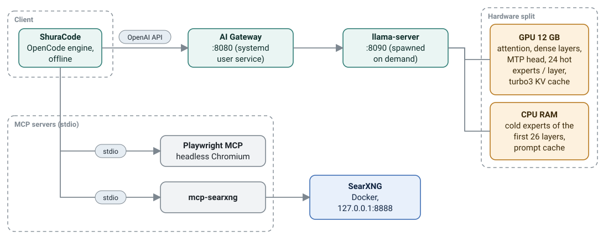
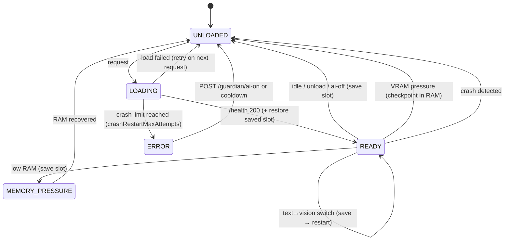

# Architecture

## Compact monitor window

`shura monitor` opens `/monitor?view=compact` in a small Chromium app window. The view also activates automatically below 420 px and polls only the state endpoint; a hidden page backs off to five-second polling. An optional gateway key is requested by the page and kept only in the current tab's `sessionStorage`, then sent in the Authorization header. It is never added to the URL.

`shura monitor --full` opens the regular page. `--autostart on|off` manages the optional desktop entry (off by default). On Plasma, `--install-rule` and `--remove-rule` manage only Shura's KWin rule; the install leaves other rules intact and backs up `kwinrulesrc`. Its initial position is at the primary screen's upper-right corner, while its size remains changeable. The Keep Above setting is forced, and the window is skipped in the taskbar, pager and window switcher. On Wayland, keeping the window above others requires a KWin rule; other desktop environments need their own manual window rule. Firefox can open the page in a tab but cannot provide the app window or KWin title match.

## Monitor data format

`GET /monitor/api/state` keeps all pre-existing top-level fields and adds `schema`, `capabilities`, `health`, `status_line`, and `monitor_self`. `schema` is the integer `1`; future revisions are additive so older clients can ignore unknown fields.

The stable legacy top-level fields are:

| Field | Contents |
|---|---|
| `header` | Selected model, mode, load state and model uptime. |
| `now` | Active request number/age, whether generation is active, and the current approximate decode rate. |
| `last_request` | Last request's first-token time, prefill/decode rates, MTP counters, finish reason and prefix reuse. |
| `context` | Tokens used/limit/percent, KV bytes, saved-slot flag and prefix reuse. The limit comes from `/slots[].n_ctx` or model `ctxSize` configuration. |
| `gpu` | GPU memory split, per-process estimate, utilization, temperature, power, PCIe and expert-cache values where available. |
| `memory` | RAM, zram, PSI and estimated weight-read fields. Missing source values are JSON `null`. |
| `cpu` | CPU temperature, frequency, per-core load and polite-mode state. |
| `reliability` | Output-limit count, request errors, server restarts/crashes, free SSD and NVMe writes. |
| `events` | Bounded, sanitized gateway event history. |
| `block_status` | Compatibility map of gateway-calculated block levels. |
| `sampled_at` | Unix timestamp of the cached monitor sample. |

`GET /monitor/api/requests` returns the existing bounded request-history array separately; it never contains prompt or response text.

`capabilities` is a map of booleans: `gpu_nvidia`, `gpu_amd`, `gpu_intel`, `system_linux`, `zram`, `psi`, `cpu_temp`, `nvme`, `slots`, `timings`, and `expert_cache`. GPU cards are shown only when a GPU source reports usable values; optional sub-blocks such as PSI, ZRAM, and NVMe are hidden when their source is absent. `slots` is true when the server has reported a real slot or the selected model configuration provides a context limit. A live slot's `n_ctx` is authoritative; the configured context is used when the model is unloaded.

`health` is decided in the gateway from `monitor_config.py` thresholds. Clients display `level` (`ok`, `warn`, or `crit`), the list of `{code, text}` reasons, and a short `hint`; they do not recalculate the overall state. `status_line` is `{code, text}` from the gateway's fixed English code dictionary. It names only conditions the gateway knows, such as a first-token wait, an active polite-mode CPU limit, a recent restart, memory pressure, or a game park; otherwise it uses a neutral message. `monitor_self` reports cumulative gateway CPU seconds, resident memory MiB, and active stream subscribers.

Example additive fields:

```json
{
  "schema": 1,
  "capabilities": {
    "gpu_nvidia": false, "gpu_amd": true, "gpu_intel": false,
    "system_linux": true, "zram": true, "psi": true, "cpu_temp": true,
    "nvme": true, "slots": true, "timings": true, "expert_cache": false
  },
  "health": {
    "level": "warn",
    "reasons": [{"code": "context_high", "text": "The active context is nearly full"}],
    "hint": "Check the items marked WARNING."
  },
  "status_line": {"code": "waiting_first_token", "text": "Waiting for the first response token"},
  "monitor_self": {"cpu_seconds": 2.4, "rss_mib": 31.2, "stream_subscribers": 1}
}
```

`GET /monitor/api/stream` sends the same full state object as SSE `data:` events once per second while a client is connected. It creates no sampling loop or thread when there are no subscribers, closes its count on disconnect, and uses the same optional Bearer-key check as the JSON API. The page uses an authenticated fetch stream so a key can remain in the tab's `sessionStorage`; if streaming is unavailable it reconnects and polls `/monitor/api/state`. Full-page request history remains a separate, slower `/monitor/api/requests` call.

Telemetry uses small source adapters with `available()` and `sample()` methods. Linux system data reads `/proc`, zram, PSI, hwmon and NVMe files independently. NVIDIA uses NVML; AMD uses documented `amdgpu` VRAM/busy sysfs values and hwmon; Intel uses available DRM `i915`/`xe` sysfs memory, busy and hwmon values. Missing attributes remain unavailable. AMD and Intel paths are covered by fixture files, not physical AMD/Intel devices. Windows currently reports its standard-library-only counters as unavailable; no external monitoring dependency is installed.

The AMD sysfs names and units follow the [kernel amdgpu memory interface](https://docs.kernel.org/6.6/gpu/amdgpu/driver-misc.html), [amdgpu thermal/hwmon interface](https://docs.kernel.org/gpu/amdgpu/thermal.html), and [standard hwmon sysfs units](https://docs.kernel.org/hwmon/sysfs-interface.html). Intel readings are used only when the corresponding DRM sysfs values exist; no extra inference is made from undocumented counters.

`shura doctor --hw-dump` prints and writes a compact diagnostics file. It includes only the OS/kernel release, GPU model/driver where available, a whitelist of PCI IDs and monitor sysfs values, and source availability. It omits usernames, home paths, hostnames, IPs, serials and process data.

## Overview



## The gateway

[`gateway/ai_gateway.py`](../gateway/ai_gateway.py) is a standard-library-only Python reverse proxy.
It speaks the llama-server/OpenAI API on port 8080 and owns the llama-server process on port 8090.
It is a Linux rewrite of an earlier PowerShell "resource guardian".

| Responsibility | How |
|---|---|
| Load on demand | The first request starts llama-server and waits for `/health`; nothing uses RAM/VRAM until needed. |
| Text ↔ vision switching | The request JSON is parsed before forwarding. An image part in `messages` (`image_url`, `input_image`) restarts the server with `--mmproj` and `visionOverrides` (fewer expert-cache slots to make room for the projector). A tool schema that merely has a property named `image_url` does not, and a model without a projector is served as text. |
| Idle unload | After `idleUnloadSeconds` (default 30 min) with no requests, the model is unloaded. |
| Memory-pressure guard | `MemAvailable` from `/proc/meminfo` below `ramFreeMinGB` for 3 polls unloads the model. A generation in flight is never interrupted. Reloading requires `ramFreeMinGBToLoad`, which stops load/unload thrashing. |
| VRAM pressure (opt-in) | `vramGuard` defaults off. Sustained pressure notifies during an active session; unloading requires 90 seconds without requests, or an emergency after the answer ends. The session is saved to tmpfs. |
| Crash recovery | An unexpected exit is detected by the monitor thread; the next request reloads. `crashRestartMaxAttempts` failures (crashes, failed loads, a server that never gets healthy, a server declared hung) within `crashWindowSeconds` (15 min) → `ERROR`. Reaching READY does not reset the count. `ERROR` ends with `POST /guardian/ai-on` or by itself after `errorCooldownSeconds` (5 min). |
| Hung server | A READY server whose `/health` fails `healthProbeFailures` times in a row (probed every `healthProbeSeconds`), or that sends nothing for `upstreamIdleSeconds` in the middle of an answer, is stopped and counted as a failure; the next request starts a fresh one. |
| Who may call it | Host, Origin and fetch-metadata checks keep web pages in your browser out (see [SECURITY.md](../SECURITY.md)); `GET` and `OPTIONS` never load the model. |
| Agent compatibility | Rewrites the agent engine's camelCase `reasoningEffort` to `reasoning_effort`. Without this, the reasoning-effort variants (fast … max) are silently ignored by llama-server. |
| Streaming | Responses without `Content-Length` (SSE) are re-chunked and flushed as they arrive. If llama-server dies mid-answer the client gets an SSE `error` event and a clean end (any other body is cut, never passed off as complete); if the client leaves, even while the model is still thinking, the upstream connection is closed so the single slot is freed. |
| Errors | The gateway's own errors on API paths use the OpenAI shape (`{"error": {"message", "type", "code"}}`), so clients show the reason. |

### State machine



### Control endpoints

| Endpoint | Effect |
|---|---|
| `GET /guardian/status` | JSON: state (`LOADING` is visible, and the call answers during a load), mode, RAM/VRAM headroom, idle time, last error, `vram_pressure`, `last_yield_reason`, `last_yield_at`, `ram_session_saved`, `vram_reload_min_gb` |
| `POST /guardian/unload` | Save slot and unload now; the next request reloads. Refused with 409 while an answer is running, unless `?force=1` |
| `POST /guardian/ai-off` · `ai-on` | Persistent manual disable / re-enable (also clears `ERROR`) |
| `POST /guardian/multimedia-lock` · `multimedia-unlock` | Free the GPU for another job (e.g. Whisper) and block loads meanwhile |

Every state-changing endpoint is POST-only. Other POST paths are proxied to llama-server unchanged; `GET`/`HEAD` reach a model that is already running but never start one (`/health` and `/v1/models` are answered by the gateway when nothing is loaded).

### Yielding VRAM to the desktop (experimental, off by default)

`vramGuard: false` alone does not run the preserved original gateway entrypoint (see the switch list near the end of this section). Existing installations do not
activate the guard when the new code is installed. Enabling it needs operator approval after isolated
validation. The live binary and model launch configuration are unchanged by this feature.

When enabled, the monitor samples card free VRAM once per second. Five consecutive seconds below
120 MiB activate pressure. An active session receives a notification and a status flag, without
unloading. Idle means **90 seconds with no requests**, measured from completion of the last request;
5–20 second tool pauses never trigger a pressure unload. A genuine emergency is below 60 MiB for ten
consecutive seconds. It can unload an active session only **after the current answer ends**. Recovery
before that cancels the pending unload. Request admission and yield use the same lifecycle lock.

Before unloading, the gateway saves one checkpoint into private, user-owned tmpfs with atomic renames.
Its SHA-256, byte size, token count and model/configuration signature are checked before restore. The
RAM checkpoint and metadata are removed immediately after successful restoration. Short sessions are
also protected. Ordinary idle/manual/shutdown saves retain the existing disk-save policy; pressure
saves never fall back to SSD. No periodic slot saves are added.

If RAM is unavailable or a save fails, pressure only notifies and keeps the live session. An emergency
may unload without a checkpoint and explicitly reports that the prompt will be read again. Bad GPU
telemetry cancels pressure timers and uses the original lifecycle. A failed/corrupt/stale restore is
never forwarded: the backend is restarted once with an empty session, and the next request refills it.
The older disk session is skipped for that recovery. Every fallback has a log event and status counter.

Reload waits at most 30 seconds, releasing the lifecycle lock between checks, then returns 503 if
memory is still unavailable. It requires the measured model-process footprint plus at least 250 MiB,
or the original minimum if larger. Without process telemetry it uses the pre-load headroom. No
background reload occurs. A save has a ten-second timeout; process termination waits ten seconds then
five seconds after killing the **owned PID**. A failed stop keeps the live PID/status visible.

After gateway restart, a compatible checkpoint is recovered; interrupted and invalid private files
are removed. A RAM ownership lease identifies the server by UID, PID, process start time and command
hash. A surviving busy server is left alone until its answer ends. Only an idle matching server can be
stopped; a reused PID is never signalled. An occupied backend port blocks a second server.

`/guardian/status` reports pressure, emergency, last event, counters, fallback, checkpoint availability,
reload threshold and monitor health/liveness. `shura status` shows those fields in plain words. Monitor
exceptions are caught and reported; later ticks retry instead of silently losing the thread.

| Guardian setting | Default | Purpose |
|---|---:|---|
| `vramGuard` | false | Kill switch; off runs the preserved original entrypoint. |
| `vramIdleSeconds` | 90 | Silence after a request before pressure can unload. |
| `vramFreeCriticalMiB` | 120 | Card free VRAM threshold. |
| `vramPressureSeconds` | 5 | Consecutive seconds below pressure threshold. |
| `vramEmergencyMiB` | 60 | Emergency threshold. |
| `vramEmergencySeconds` | 10 | Consecutive seconds below emergency threshold. |
| `vramReloadWaitSeconds` | 30 | Maximum request wait before 503. |
| `vramPressureSlotDir` | `/dev/shm` | Existing tmpfs parent; private per-state directory. |
| `vramPressureSlotReserveMiB` | 512 | Minimum tmpfs free space and RAM above `ramFreeMinGB`; the 187k slot is about 1.19 GiB (1,273,555,436 bytes with one checkpoint appendix). |

After an approved deployment, rollback is one operator command from the repository root:
`python3 scripts/rollback_gateway.py --config-dir config`. It waits up to 90 seconds for the active
answer, gates new requests, backs up the guardian config, atomically disables `vramGuard`, restarts
only the existing user service, and restores the prior manual on/off setting. A failed restart restores
the original config and retries the service. This command has offline tests and has **not** been run
against the live service. Part A preserves the original gateway source in `_gateway_legacy.py` and does
not replace the llama-server binary. The preserved legacy gateway runs only when all of `vramGuard`,
`slotSaveCheckpoints`, `gameMode`, `politeModel`, `slotGears` and `crashRecovery` are off; turning on any one of them selects the new gateway. Before a later binary deployment, a verified binary backup and
its rollback step must be added.

The revised guard has offline fault tests. **GPU validation and acceptance are pending.** The earlier
prototype passed interleaved speed/quality checks but hit the zram growth stop before final 9/9 after
restore; those results do not accept the revised implementation. See
[benchmark notes](BENCHMARKS.md#elastic-vram-part-a-guardian-acceptance-2026-09-30).

No periodic metrics are written to disk. Emergency slot bytes and metadata stay in RAM (0 GB/day of
SSD checkpoint writes), including after gateway restart. Transition/error messages use the existing
journal logger, so logging is not literally zero-write. Two hardware yields measured 250 bytes total
for their new event lines: 100 yields/day add about 12.5 KB (0.0000125 GB/day); a pathological
yield every 5 seconds adds about 2.16 MB/day (0.00216 GB/day), excluding existing load/restore
messages. There is no per-second metrics log. The 187k benchmark seed occupied 819,157,096 bytes in RAM.
Normal unload still writes to SSD only above the original token threshold. It now stages in tmpfs and
atomically copies to `slotSaveDir`; the bytes per ordinary disk checkpoint are unchanged.

## KV cache and SSD wear

Re-prefilling a 187k-token session takes about 4.5 minutes, so reusing the KV state matters a lot for
agentic coding. The obvious approach is to dump the slot to disk after every response. That costs
~780 MB per save, and an agent session makes a request per tool call. Estimated against the SSD's
1,600 TBW rating:

| Strategy | Writes/day (heavy use) | Rated endurance consumed |
|---|---:|---|
| Save after every response (hundreds/day at 100-187k tokens) | 135-640 GB | full rating in ~7-32 years |
| Save only when switching sessions | 10-25 GB | negligible |
| **Keep in RAM, save only on model unload (this project)** | a few GB | negligible |

What this stack does:

1. **Session switching happens in RAM.** llama-server's host prompt cache (`--cache-ram 4096`) keeps
   the states of recent conversations; returning to a 187k session re-processes ~19 tokens (1.9 s).
   Context checkpoints (`--ctx-checkpoints`, default 32) let the hybrid Gated-DeltaNet model reuse a
   prefix even though its recurrent state cannot be rewound token by token.
2. **Ordinary unloads may touch disk; VRAM pressure never does.** When the gateway unloads the model (idle, memory pressure,
   manual, shutdown), it saves slot 0 to `slotSaveDir`, and only if it holds at least
   `slotSaveMinTokens` (20k) tokens. Below that size, a fresh prefill takes seconds anyway.
3. **One disk file per mode, atomically replaced each time**, so disk usage is bounded (~0.8 GB). After the next
   load the gateway restores it automatically. If the next request continues that conversation, it
   resumes in ~13 s including model load; if not, the restore costs 0.2 s and is simply discarded.

Caveat: an *identical* repeated prompt cannot reuse a restored slot on this hybrid architecture
(the last token must be re-evaluated and the recurrent state cannot step back). A real continuation
of the conversation works as expected.

Native checkpoint mutations (`POST`, `PUT`, `DELETE`, or `PATCH` on `/slots`) are private to the gateway lifecycle. The public gateway rejects them with HTTP 403 before loading a model, in both gateway implementations. Internal A2 save/restore calls still go directly to the owned backend and enforce model/mode ownership. Controlled native slot benchmarks must address their isolated llama-server directly. Read-only slot inspection remains available.

## Opt-in game parking

`gameMode` and automatic detector flags default to false. The mode uses A2 RAM snapshots and independent NVML/Steam/reaper/GameMode signals. Known desktop processes and the owned model are excluded. Activation requires5s; release requires60s quiet and never preloads the model. `shura pause`/`resume` use the same policy; status reports PARKED_BY_GAME, reason and elapsed time.

Paused/draining admission returns503 with Retry-After. Active responses get up to gameDrainSeconds (default60); timeout produces an explicit game_pause_timeout SSE error or503. Stop follows a successful atomic A2 save; save failure keeps the server loaded and retries after30s. Ordinary idle save policy is unchanged. Snapshots are removed after restore.

Isolated reduced4 tests:187k A2 cache_n186999/prompt_n33,6GiB CUDA hog after parking,3s false signal,20s flaps,manual control,final9/9. Real timeout used reduced4/mmap after load-mode none hit the PSI guard. Three short-context matched pairs gave medianON/OFF0.9814,identical output/MTP;CPU<=2.5 and pair delta<=0.8. GameMode registration was mocked to avoid its system-tuning hooks; installed ClientCount query inspected. Real games and instant VRAM allocation surges were not tested: delayed detection cannot guarantee game-start headroom. Local evidence:ignored bench/results/game-mode-a2-20261001.

## Offline reliability prototypes (default off)

`politeModel` uses the owning user-systemd service's cgroup v2 CPUWeight, not irreversible
nice/SCHED_IDLE changes. The default-off feature offers `politeMode=static` (candidate weight20)
and `politeMode=dynamic` (existing PSI/wakeup/non-model CPU AIMD, weights100/50/20/5, five-second
minimum interval and30-second calm recovery). Static mode has no PSI/wakeup observer or AIMD dependency. CPUWeight is work-conserving; GPU proof must decide
whether constant weight alone is enough. No CPUQuota is applied. L3 optionally reserves one physical
core using reversible affinity; static mode leaves native thread affinity unchanged.

The executor verifies that the gateway and model belong to its configured `politeUnit` before changes.
Only user `systemctl --no-ask-password set-property --runtime` is used. An independent weight100
service hosts the wakeup probe so model throttling does not falsify desktop latency. Original weight
and pending changes are leased atomically in private RAM. Normal shutdown restores the original;
startup can restore after SIGKILL, including death before the property write. External property changes
are respected rather than overwritten. Runtime properties themselves persist across service stops;
explicit cleanup is essential. Status and CLI show mode, level, weight, errors and command duration.
Syscall/property failures disable the controller and attempt restoration; RAM/VRAM/game policies remain.

`slotGears` requires A2 (`slotSaveCheckpoints >= 1`). Its independent per-model ratchet defaults to
26/24/20/16, never grows beyond the configured baseline, waits 60 seconds below 250 MiB to reduce slots,
and 30 minutes above the corridor plus the next step's estimated memory to grow them.
Only idle gaps permit a change. A global budget shared by both models allows two attempts per hour
and six per day, including failed attempts. The small budget ledger survives gateway restarts in
private tmpfs; malformed or unwritable ledgers disable gears. Runtime slot overrides never edit the
model configuration files. `apply_slots(n)` is separate from the policy, allowing future live resize.

The restart mechanism saves and validates A2 before stopping, retains one hardlink in tmpfs throughout
the transaction, and accepts the new gear only after checkpoint restoration. Failure restores the
old gear and snapshot. A failed rollback disables gears, blocks admission and retains the recovery
file instead of discarding it. A private tmpfs journal rolls an interrupted gateway transaction
back to the original gear and verified A2 file on startup; a changed model/binary or corrupt snapshot
blocks admission for manual inspection. When gears are disabled the configured static baseline is
used. Each restart/rollback has its own 20-second deadline (including stop, post-stop telemetry,
spawn/health and restore); a failed attempt plus rollback can take twice that, rather than a
180-second health wait per attempt. Changes other than slot count invalidate the transaction. Vision
profiles are excluded pending their own quality gates. Status reports each model's slots and reason.
These features have offline fault coverage, **not GPU or quality acceptance**. Keep them off until
both model benchmarks and the slot-count PPL/KL gates pass. No footer integration is claimed here.

The opt-in vramCardReserveMiB admission chooses the largest supported cache level whose estimated
post-load free VRAM on the whole card meets the reserve; it sets only the initial level and leaves
later changes to the existing slotGears ratchet.

`crashRecovery` is default-off and requires A2. Before each inference it protects the previous
context in RAM. Requests are serialized for recovery; failed protection returns503 before any response.
Upstream headers and the first body read are buffered. If the owned backend died and zero response
bytes (including HTTP headers) reached the client, one gateway replay is allowed after fresh admission,
restart and A2 restore. No replay is allowed after end_headers, even if no text token has arrived.

Interrupted streams receive `SHURA_RESPONSE_INTERRUPTED` with a non-retryable message and no fake
DONE marker. Installed OpenCode1.18.32 shows an UnknownError and exits1 without another provider
request; a completed tool remains executed once. Before-byte503/Retry-After is retried and succeeds.
A departing downstream client is never grounds for backend restart. Game cancellation takes precedence
and never invokes recovery; its in-stream error is likewise non-retryable. GPU/server-kill/187k timing,
RAM overhead and final9/9 remain hardware acceptance tasks. If the gateway itself is killed or the
client connection is already lost, it cannot deliver a terminal error: that transport failure is outside
the tested no-replay guarantee.

Unexpected llama-server exits write a bounded `~/.local/state/ai-gateway/crashes/crash-*.json`
record from the gateway monitor. It includes the exit signal/code, recent gateway journal lines,
state and sanitized launch arguments; records are capped at 64 KiB and the ring retains ten. Journal
lookup failure is recorded without stopping the gateway. Server stdout/stderr stays attached to the
unit journal; it is not piped through the gateway, avoiding SIGPIPE if the gateway exits.

Gateway-owned saved slots have an atomic JSON sidecar with byte count, SHA-256, model/mode signature
and token count. Both disk and RAM checkpoints are checked before the native restore endpoint is
called. Legacy disk slots without that sidecar are refused and the next prompt is read normally; a
truncated, changed or mismatched checkpoint never reaches llama.cpp. CPU `poll`, `threads` and
`threadsBatch` changes are excluded from the model-state signature because they do not change the
serialized KV/draft tensors; benchmarks can therefore restore the same verified session across those
settings.

The separate vramValve uses fresh whole-card free VRAM to resize a live expert cache only at an idle
request boundary; the gateway defers while busy and the server independently rejects active-slot
resizes. Its default-off ladder can be overridden per model and is clipped to that model's maximum.
The per-model slot price resolves from a validated configured value, then an in-memory rolling mean
of up to three settled and uncontended resizes, then the legacy global estimate. Zero remains
excluded from the recommended ladder pending resolution of the repeatable token mismatch. Vision
mode is inactive and reports its actual slot count. It is mutually exclusive with slotGears, and
parks through A2 and vramGuard if the configured minimum positive level still cannot restore reserve.
